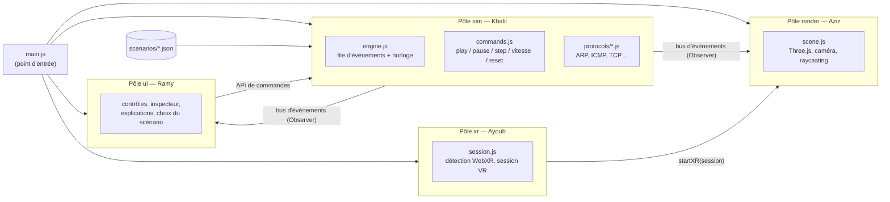
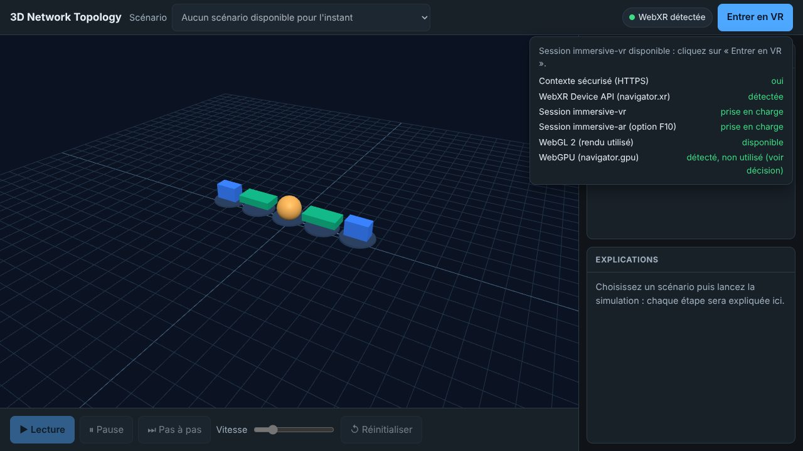
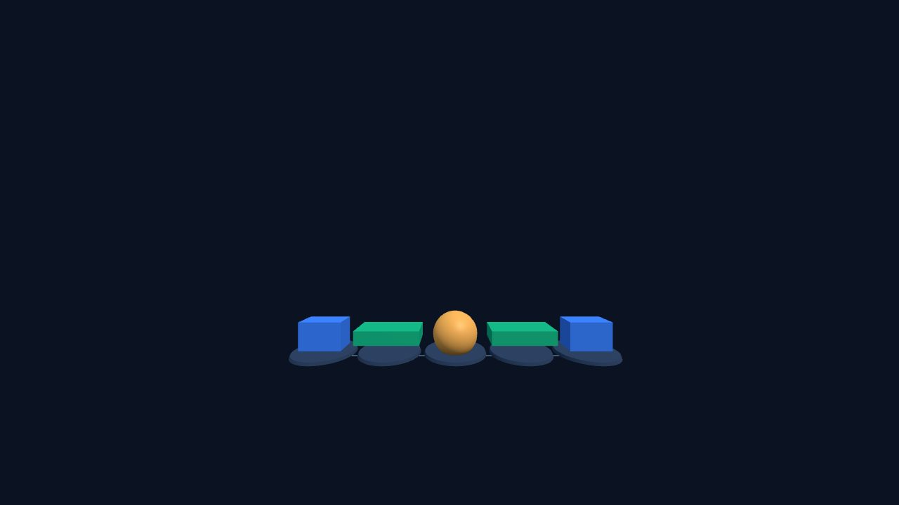

# 3D Network Topology

[](https://github.com/Bensabbehayoub/3D-network-topology/actions/workflows/ci.yml)

Application web pédagogique qui fait **voir** les protocoles réseau (ARP, ICMP, DNS, DHCP, TCP, UDP, HTTP, routage statique) circuler dans une **topologie 3D** interactive. Elle s'ouvre par une simple URL HTTPS, peut s'installer comme PWA et s'explore à la souris, au doigt ou **en VR (WebXR)**, sans casque grâce à l'émulateur de Chrome.

Projet du cycle ingénieur, **SUP'COM, département SIA**. Superviseur : Dr. Eng. Mohamed Becha Kaaniche.
Durée : 7 sprints d'une semaine, du 2 novembre au 20 décembre 2026.

- **Application en ligne** : https://bensabbehayoub.github.io/3D-network-topology/
- **Planning détaillé et suivi des tâches** : [`docs/planning.md`](docs/planning.md)
- **Documentation** : [`docs/README.md`](docs/README.md)

---

## Sommaire

1. [Problématique et objectifs](#1-problématique-et-objectifs)
2. [Équipe et répartition des rôles](#2-équipe-et-répartition-des-rôles)
3. [Planning des sprints](#3-planning-des-sprints)
4. [Architecture technique](#4-architecture-technique)
5. [État actuel](#5-état-actuel-fin-du-sprint-s1)
6. [Lancer le projet](#6-lancer-le-projet)
7. [Tester la VR sans casque](#7-tester-la-vr-sans-casque)
8. [Organisation du travail](#8-organisation-du-travail)

---

## 1. Problématique et objectifs

Les schémas statiques expliquent mal les échanges entre protocoles, le trajet des paquets et le rôle de chaque équipement. Installer un logiciel spécialisé freine aussi la découverte.

> Comment aider les étudiants ingénieurs à comprendre les protocoles réseau en visualisant leurs échanges dans une topologie 3D interactive, accessible depuis un navigateur, sans installation ni matériel XR dédié ?

| Réf. | Fonctionnalité | Priorité | Sprint |
| --- | --- | --- | --- |
| F01 | Charger une topologie (JSON) et l'explorer en 3D, souris ou tactile | Essentiel | S1–S2 |
| F02 | Animer les messages, avec une explication à chaque étape | Essentiel | S2–S3 |
| F03 | Scénarios ARP, ICMP (ping), DNS, DHCP, TCP, UDP | Prioritaire | S3–S4 |
| F04 | HTTP et routage statique | Progressif | S5 |
| F05 | Inspecter un paquet (MAC, IP, ports, TTL, indicateurs) | Essentiel | S3 |
| F06 | Lecture, pause, pas à pas, vitesse, réinitialisation | Essentiel | S2 |
| F07 | Accès par URL HTTPS, installation PWA facultative, hors ligne | Essentiel | S5–S6 |
| F08 | Mode classique PC/mobile et mode VR WebXR (émulable) | Essentiel | S1, S4–S5 |
| F09 | Extensions : IPv6, TLS, OSPF… | Extension | S7 si le temps le permet |
| F10 | Pose de la topologie en AR (hit testing) | Option | hors plan |

## 2. Équipe et répartition des rôles

Chaque membre est **propriétaire** d'un pôle : lui seul modifie ses fichiers ; les autres passent par une issue ou une pull request qu'il approuve. La règle est appliquée par [`.github/CODEOWNERS`](.github/CODEOWNERS) et la protection de la branche `main`.

| Membre | GitHub | Pôle | Fichiers possédés | Protocoles | Livrables écrits |
| --- | --- | --- | --- | --- | --- |
| **Ramy Driouech** | [ramydriwech](https://github.com/ramydriwech) | Interface pédagogique | `index.html`, `styles.css`, `src/ui/` | DHCP, HTTP | Cas d'utilisation, cahier conceptuel, manuel utilisateur, script et voix off de la vidéo |
| **Mohamed Aziz Saoudi** | [zyyyyyyyyyyz](https://github.com/zyyyyyyyyyyz) | Rendu 3D | `src/render/` (sauf `packetAnimator.js`), `vendor/three/`, `assets/models/` | ICMP, UDP, DNS | Diagramme de séquence du ping, doc du rendu, captures et montage vidéo |
| **Khalil Krifa** | [111JOJO111](https://github.com/111JOJO111) | Moteur de simulation | `simulation.js`, `src/sim/` (moteur, hôte, routeur), `tests/` | ARP, TCP, routage statique | Diagramme de classes, doc de la simulation et de l'architecture |
| **Ayoub Ben Sabbeh** | [Bensabbehayoub](https://github.com/Bensabbehayoub) | Plateforme et XR | `main.js`, `manifest.json`, `sw.js`, `.github/`, `tools/`, `src/xr/`, `src/render/packetAnimator.js`, `src/sim/devices/switch.js` | Commutation L2 | Diagramme de déploiement, doc de lancement et de déploiement |

Binômes de relecture : Khalil ↔ Ayoub, Aziz ↔ Ramy. Pair programming prévu sur les jonctions critiques : moteur ↔ animation (S2), ARP ↔ switch et ICMP ↔ inspecteur (S3), lisibilité en VR (S5).

Le détail des **79 tâches** (membre, fichiers, points, statut) est dans [`docs/planning.md`](docs/planning.md). Chaque membre porte 45 points d'effort sur le projet.

## 3. Planning des sprints

| Sprint | Dates | Phase | Résultat démontré le dimanche | Jalon | État |
| --- | --- | --- | --- | --- | --- |
| **S1** | 2–8 nov | Fondations et contrats | Site en ligne qui affiche une topologie ; contrats communs et mocks validés ; renderer choisi | — | ✅ terminé |
| **S2** | 9–15 nov | Scène 3D et moteur d'évènements | Un paquet de test traverse le réseau et obéit aux 5 commandes | — | 🔄 en cours |
| **S3** | 16–22 nov | ARP, ICMP et inspection | Ping complet entre deux PC : ARP puis ICMP, pause, pas à pas, inspection | **MVP (22 nov)** | |
| **S4** | 23–29 nov | Catalogue de protocoles | DHCP, UDP, DNS, TCP sélectionnables ; entrée/sortie VR dans l'émulateur | — | |
| **S5** | 30 nov–6 déc | VR, PWA et extensions | HTTP, routage statique, VR complète, installation PWA : démo §3.1 étapes 1 à 6 | **Démo complète (6 déc)** | |
| **S6** | 7–13 déc | Stabilisation et hors ligne | Hors ligne, tests, documentation ; un membre qui n'a pas codé rejoue la démo | **Gel, v1.0-rc (13 déc)** | |
| **S7** | 14–20 déc | Livraison (tampon) | Vidéo de 5 min, livrables, deux répétitions de soutenance | **v1.0 (18 déc), remise (20 déc)** | |

## 4. Architecture technique

### Choix techniques

| Besoin | Choix | Pourquoi |
| --- | --- | --- |
| Rendu 3D | **Three.js r180**, `WebGLRenderer` (WebGL 2), copié dans `vendor/three/` | Une seule voie de rendu pour PC, mobile et VR. `WebGPURenderer` n'ouvre pas de session VR dans l'émulateur : essai et justification dans [`docs/decision-renderer.md`](docs/decision-renderer.md). WebGPU reste détecté et affiché. |
| Réalité virtuelle | **WebXR Device API** (`immersive-vr`), testée avec **Immersive Web Emulator** | Aucun casque disponible ; même code pour un vrai casque. |
| Simulation | Moteur **à évènements discrets**, en JavaScript pur, sans navigateur | Déterministe, indépendant des images (pause, pas à pas et vitesse cohérents), testable sous Node. |
| Application | **PWA** : `manifest.json` + Service Worker | Accès par URL, installation facultative, hors ligne après le premier chargement. |
| Hébergement | **GitHub Pages** en HTTPS, déployé par GitHub Actions | Gratuit ; HTTPS obligatoire pour WebXR et le Service Worker. |
| Code | Modules ES natifs, **aucune étape de build**, aucune dépendance CDN | Le dépôt est servi tel quel ; le hors ligne reste possible. |
| Tests | `node --test` (exécuteur intégré à Node 22), lancé par la CI à chaque pull request | Aucun outil à installer. |

### Les quatre pôles

`main.js` charge les pôles dans cet ordre ; chacun expose `init(app)` et reçoit les API des pôles précédents. Ils ne communiquent que par des **contrats figés en S1** ([`docs/simulation/contrats.md`](docs/simulation/contrats.md)).



Le flux d'une simulation : le scénario JSON décrit la topologie et les textes ; le protocole programme des envois dans le moteur ; le moteur publie chaque envoi, réception ou perte sur le bus ; le rendu anime le paquet, l'interface affiche l'explication et le journal. Détails et diagramme de déploiement : [`docs/architecture.md`](docs/architecture.md).

### Arborescence

```text
index.html, styles.css      page et mise en page (points de montage des pôles)
main.js                     charge les quatre pôles, enregistre le Service Worker
manifest.json, sw.js        PWA
simulation.js               façade publique du moteur
src/sim/                    moteur, états, commandes, bus, faux moteur, équipements, protocoles
src/render/                 scène Three.js, topologie, styles des paquets, animation
src/ui/                     contrôles, sélection, inspecteur, explications, installation
src/xr/                     détection WebXR, session VR, panneau et manettes VR
scenarios/                  un fichier JSON par scénario (topologie + étapes expliquées)
tests/                      tests automatiques (node --test)
vendor/three/               Three.js r180 copié localement (hors ligne)
docs/                       documentation (voir docs/README.md)
.github/                    CI, déploiement Pages, CODEOWNERS
```

## 5. État actuel (fin du sprint S1)

| Fonctionne aujourd'hui | Prévu ensuite |
| --- | --- |
| Site en HTTPS sur GitHub Pages, déployé à chaque fusion dans `main` | Moteur réel et animation des paquets (S2) |
| Scène Three.js : rotation et zoom à la souris et au doigt, sélection d'un équipement | Modèles 3D GLB, câbles et étiquettes (S2) |
| La scène affiche la topologie du scénario chargé par le moteur | Ping ARP + ICMP de bout en bout (S3, MVP) |
| **Détection WebXR** : statut « WebXR détectée / non détectée » et détail (VR, AR, WebGL 2, WebGPU, HTTPS) | Panneau de commandes en 3D dans la VR (S4) |
| **Entrée et sortie de session `immersive-vr`** dans l'émulateur, scène affichée devant l'utilisateur | Sélection à la manette (S5) |
| Contrats communs (scénario, évènements, protocole, commandes) et faux moteur | Six protocoles (S4), HTTP et routage (S5) |
| Interface : en-tête, commandes, inspecteur, explications ; PC et mobile | Hors ligne complet (S6) |
| CI : tests automatiques à chaque pull request | |

| Statut WebXR (mode classique) | Session VR dans l'émulateur |
| --- | --- |
|  |  |

## 6. Lancer le projet

Il n'y a rien à compiler : il suffit de servir le dossier. WebXR et le Service Worker exigent **HTTPS ou `localhost`** ; ouvrir `index.html` directement (`file://`) ne fonctionne pas.

```bash
git clone https://github.com/Bensabbehayoub/3D-network-topology.git
cd 3D-network-topology

# serveur local, au choix :
python -m http.server 8000        # puis http://localhost:8000
npx serve .                       # ou tout autre serveur statique

# tests automatiques (Node 22 ou plus récent)
node --test
```

Déploiement : chaque fusion dans `main` relance la CI, qui teste puis publie le site sur GitHub Pages. Aucune action manuelle.

## 7. Tester la VR sans casque

1. Installer l'extension **Immersive Web Emulator** dans Chrome (Chrome Web Store, éditeur Meta).
2. Ouvrir l'application (en ligne ou sur `localhost`).
3. Ouvrir les outils de développement (F12), onglet **WebXR**, et choisir un appareil (par exemple Meta Quest 3).
4. Recharger la page : le badge en haut à droite passe à **« WebXR détectée »** avec un point vert, et **« Entrer en VR »** devient cliquable.
5. Cliquer sur **Entrer en VR** : la topologie s'affiche devant l'utilisateur. On déplace le casque et les manettes dans l'onglet WebXR. **Quitter la VR** ramène au mode classique.

Sans WebXR (Firefox, Safari, ou Chrome sans casque), le badge affiche **« WebXR non détectée »** ou **« WebXR détectée »** avec un point orange, le bouton reste désactivé et le mode 2D reste entièrement utilisable. Cliquer sur le badge affiche le détail des capacités détectées.

## 8. Organisation du travail

- **Méthode XP** : sprint d'une semaine ; planning le lundi (cartes sur GitHub Projects), stand-up le mercredi et le vendredi, démo sur GitHub Pages et rétrospective le dimanche.
- **Git** : une branche par tâche, `feature/<membre>-<sujet>` ; push quotidien ; fusion dans `main` par pull request le mercredi et le dimanche, après `git pull --rebase origin main`.
- **Revue** : la pull request doit passer la CI et être approuvée par le propriétaire des fichiers touchés (CODEOWNERS).
- **Définition de « terminé »** : fusionné dans `main`, aucune erreur dans la console, vérifié sur Chrome desktop et sur un smartphone ; pour un protocole, un test de la séquence de messages et une explication pour chaque étape.
- **Contrats** : toute modification d'un contrat commun (format de scénario, évènements, API de commandes) passe par une pull request relue par les quatre.
- Un bug trouvé dans le fichier d'un autre devient une **issue** assignée à son propriétaire.
- **Versions** : un tag par fin de sprint (`v0.1` … `v0.6`), puis `v1.0-rc` et `v1.0`.
