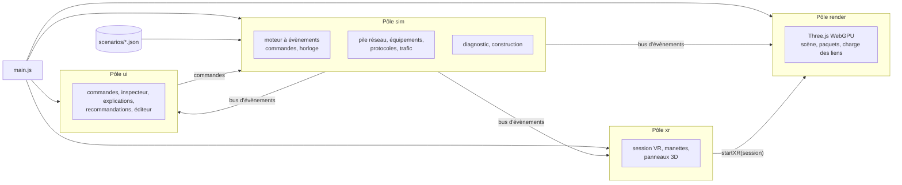

# 3D Network Topology

[](https://github.com/Bensabbehayoub/3D-network-topology/actions/workflows/ci.yml)

Application web pédagogique qui fait **voir** les protocoles réseau (ARP, ICMP, routage statique, UDP, DNS, DHCP, TCP, HTTP) circuler dans une **topologie 3D** interactive. Elle s'ouvre par une simple URL HTTPS, s'installe comme application (PWA), fonctionne **hors ligne**, s'explore à la souris, au doigt ou **en réalité virtuelle (WebXR)**, et permet de **construire son propre réseau** puis de le diagnostiquer et de le simuler.

Projet du cycle ingénieur, **SUP'COM, département SIA**. Superviseur : Dr. Eng. Mohamed Becha Kaaniche.
Durée : 7 sprints d'une semaine, du 2 novembre au 20 décembre 2026.

- **Application en ligne** : https://bensabbehayoub.github.io/3D-network-topology/
- **Manuel utilisateur** : [`docs/manuel.md`](docs/manuel.md)
- **Documentation** : [`docs/README.md`](docs/README.md) · **Planning** : [`docs/planning.md`](docs/planning.md)


---

## Sommaire

1. [Problématique et objectifs](#1-problématique-et-objectifs)
2. [Fonctionnalités](#2-fonctionnalités)
3. [Lancer le projet](#3-lancer-le-projet)
4. [Tester la VR sans casque](#4-tester-la-vr-sans-casque)
5. [Architecture technique](#5-architecture-technique)
6. [Tests et intégration continue](#6-tests-et-intégration-continue)
7. [Équipe et organisation](#7-équipe-et-organisation)

---

## 1. Problématique et objectifs

Les schémas statiques expliquent mal les échanges entre protocoles, le trajet des paquets et le rôle de chaque équipement. Installer un logiciel spécialisé freine aussi la découverte.

> Comment aider les étudiants ingénieurs à comprendre les protocoles réseau en visualisant leurs échanges dans une topologie 3D interactive, accessible depuis un navigateur, sans installation ni matériel XR dédié ?

| Réf. | Fonctionnalité | Priorité | État |
| --- | --- | --- | --- |
| F01 | Charger une topologie (JSON) et l'explorer en 3D, souris ou tactile | Essentiel | ✅ 11 scénarios, éditeur, import JSON |
| F02 | Animer les messages, avec une explication à chaque étape | Essentiel | ✅ |
| F03 | ARP, ICMP (ping), DNS, DHCP, TCP, UDP | Prioritaire | ✅ |
| F04 | HTTP et routage statique | Progressif | ✅ |
| F05 | Inspecter un paquet (MAC, IP, ports, TTL, indicateurs) | Essentiel | ✅ toutes les couches |
| F06 | Lecture, pause, pas à pas, vitesse, réinitialisation | Essentiel | ✅ en 2D et en VR |
| F07 | Accès par URL HTTPS, installation PWA facultative, hors ligne | Essentiel | ✅ |
| F08 | Mode classique PC/mobile et mode VR WebXR (émulable) | Essentiel | ✅ rendu 100 % WebGPU |
| F09 | Extensions : IPv6, TLS, OSPF… | Extension | Non réalisé (TLS montré par la CI, [`docs/ci-cd.md`](docs/ci-cd.md)) |
| F10 | Pose de la topologie en AR (hit testing) | Option | Non réalisé |

S'y ajoutent, demandés par le superviseur pendant la refonte : caractéristiques des équipements et mesure du débit, diagnostic et recommandations, éditeur de topologie, vérification HTTPS et TLS du site publié.

## 2. Fonctionnalités

### Explorer et simuler

- **11 scénarios** choisis dans l'en-tête : ARP, ping, routage statique, TTL expiré, UDP, DNS, DHCP, TCP, HTTP, débit (goulot d'étranglement), diagnostic (réseau mal configuré).
- Un **vrai moteur de simulation** : switches qui apprennent les adresses MAC, routeurs qui décrémentent le TTL et suivent leur table de routage, caches ARP, ports ouverts ou fermés, connexions TCP avec numéros de séquence, pertes et retransmissions.
- **Commandes** : lecture, pause, pas à pas, vitesse de ×0,25 à ×4, réinitialisation ; au clavier aussi.
- **Explications** de chaque étape et **journal** des messages, avec une couleur par protocole.

| Inspecteur de paquet | Fiche d'équipement et lien saturé |
| --- | --- |
|  |  |

- **Inspecteur** : un clic sur un message du journal ou sur un paquet en vol affiche son trajet et tous ses champs (Ethernet, IP, UDP/TCP, ARP, DNS, DHCP, HTTP).
- **Fiche d'équipement**, comme une fiche produit : modèle (catalogue générique, références fictives), caractéristiques, ports avec leur vitesse et l'équipement relié, **débit et charge en direct**. Les câbles changent de couleur selon leur charge.

### Diagnostiquer


L'onglet **Recommandations** analyse la topologie, la configuration et le trafic mesuré : adresse en double, passerelle hors sous-réseau, route manquante, câble trop lent, lien saturé, boucle de commutation, point de défaillance unique… Chaque problème donne sa cause et sa correction ; un clic le montre dans la scène.

### Construire


Le mode **Construire** permet d'ajouter des équipements du catalogue, de les déplacer à la souris ou au doigt, de les relier, de configurer adresses (proposées automatiquement), passerelles, routes et rôles (serveur DHCP, DNS, web), puis de **jouer** la topologie avec l'un des 9 protocoles. Le diagnostic suit la construction en direct. Les topologies s'enregistrent dans le navigateur et s'exportent en JSON.

### Partout, même hors ligne, même en VR

| Réalité virtuelle (émulateur) | Téléphone |
| --- | --- |
|  |  |

- **VR (WebXR)** : la topologie devient une maquette posée devant soi ; pupitre de commandes, fiche d'équipement, explications et recommandations en 3D, sélection au rayon des manettes.
- **PWA** : bouton « Installer », fonctionnement hors ligne après la première visite.
- **Rendu 100 % WebGPU** (Three.js r187), y compris en VR ; sans WebGPU, un message l'indique.

## 3. Lancer le projet

Il n'y a rien à compiler : il suffit de servir le dossier. WebXR, WebGPU et le Service Worker exigent **HTTPS ou `localhost`** ; ouvrir `index.html` directement (`file://`) ne fonctionne pas.

```bash
git clone https://github.com/Bensabbehayoub/3D-network-topology.git
cd 3D-network-topology

python -m http.server 8000        # puis http://localhost:8000
node --test                       # tests automatiques (Node 22 ou plus récent)
```

Navigateur : **Chrome ou Edge récents** (WebGPU). Pendant le développement, cocher *Disable cache* dans les outils (F12, onglet *Network*) : sinon le Service Worker peut servir une version précédente.

Déploiement : chaque fusion dans `main` relance la CI, qui teste, publie le site sur GitHub Pages puis vérifie le site en HTTPS. Aucune action manuelle ([`docs/ci-cd.md`](docs/ci-cd.md)).

## 4. Tester la VR sans casque

1. Installer l'extension **Immersive Web Emulator** dans Chrome (Chrome Web Store, éditeur Meta).
2. Ouvrir l'application, puis les outils de développement (F12), onglet **WebXR**, et choisir un appareil (par exemple Meta Quest 3).
3. Le badge en haut à droite affiche **« WebXR détectée »** avec un point vert : cliquer sur **Entrer en VR**.
4. Dans l'onglet WebXR, déplacer le casque et les manettes ; viser un bouton du pupitre ou un équipement et appuyer sur la gâchette. **Quitter la VR** ramène au mode classique.

Détails : [`docs/manuel.md`](docs/manuel.md#réalité-virtuelle). Sans WebXR, le mode 2D reste entièrement utilisable.

## 5. Architecture technique

| Besoin | Choix | Pourquoi |
| --- | --- | --- |
| Rendu 3D | **Three.js r187**, `WebGPURenderer`, copié dans `vendor/three/` | Rendu 100 % WebGPU demandé par le superviseur, y compris en VR (pont `src/render/xrBridge.js` pour l'émulateur). Essais : [`docs/decision-renderer.md`](docs/decision-renderer.md). |
| Réalité virtuelle | **WebXR Device API** (`immersive-vr`), testée avec Immersive Web Emulator | Aucun casque disponible ; même code pour un vrai casque. |
| Simulation | Moteur **à évènements discrets** en JavaScript pur | Déterministe (pause, pas à pas, vitesse cohérents), testable sous Node, indépendant du nombre d'images par seconde. |
| Application | **PWA** : `manifest.json` + Service Worker | Accès par URL, installation facultative, hors ligne. |
| Hébergement | **GitHub Pages** en HTTPS, déployé par GitHub Actions | HTTPS obligatoire pour WebXR, WebGPU et le Service Worker. |
| Code | Modules ES natifs, **aucune étape de build, aucune dépendance** à l'exécution, aucun CDN | Le dépôt est servi tel quel ; le hors ligne reste possible. |

`main.js` charge quatre pôles dans l'ordre (`sim`, `render`, `ui`, `xr`) ; chacun expose `init(app)` et ne parle aux autres que par des **contrats** ([`docs/simulation/contrats.md`](docs/simulation/contrats.md)).



Détails, diagrammes de déploiement, de séquence et de classes : [`docs/architecture.md`](docs/architecture.md) et [`docs/cahier-conceptuel.md`](docs/cahier-conceptuel.md).

```text
index.html, styles.css      page et mise en page
main.js                     charge les quatre pôles, enregistre le Service Worker
manifest.json, sw.js        PWA (installation, hors ligne)
simulation.js               façade publique du pôle sim
src/sim/                    moteur, pile réseau, équipements, protocoles, trafic, diagnostic, éditeur
src/render/                 scène WebGPU, topologie, paquets, pont WebXR
src/ui/                     interface : commandes, inspecteur, journal, recommandations, éditeur
src/xr/                     session VR, manettes, panneaux 3D
scenarios/                  scénarios fournis (JSON) et leur liste (index.json)
assets/                     modèles 3D générés par script, icônes de la PWA
tests/                      tests du moteur (node --test) ; les autres sont à côté de leur module
tools/                      précache hors ligne, icônes, vérification HTTPS et TLS
vendor/three/               Three.js r187 (build WebGPU)
docs/                       documentation
```

## 6. Tests et intégration continue

- **393 tests automatiques** (`node --test`, sans navigateur), à 0 échec : moteur, chaque protocole, équipements, diagnostic, éditeur, interface, rendu, VR, PWA, CI.
- La CI ([`.github/workflows/ci.yml`](.github/workflows/ci.yml)) teste chaque pull request ; chaque fusion dans `main` est publiée, puis le site est vérifié en HTTPS (version TLS, suite de chiffrement, certificat) ; la vérification est refaite chaque semaine.
- Les fonctionnalités sont aussi vérifiées dans Chrome piloté par script (mode classique, mobile, VR émulée, hors ligne) : voir [`docs/avancement.md`](docs/avancement.md).

## 7. Équipe et organisation

| Membre | GitHub | Pôle d'origine | Livrables écrits |
| --- | --- | --- | --- |
| **Ramy Driouech** | [ramydriwech](https://github.com/ramydriwech) | Interface pédagogique (`src/ui/`, `index.html`, `styles.css`) | Cas d'utilisation, cahier conceptuel, manuel utilisateur, vidéo |
| **Mohamed Aziz Saoudi** | [zyyyyyyyyyyz](https://github.com/zyyyyyyyyyyz) | Rendu 3D (`src/render/`, `vendor/three/`, `assets/models/`) | Diagramme de séquence du ping, captures et montage vidéo |
| **Khalil Krifa** | [111JOJO111](https://github.com/111JOJO111) | Moteur de simulation (`simulation.js`, `src/sim/`, `tests/`) | Diagramme de classes, doc de la simulation |
| **Ayoub Ben Sabbeh** | [Bensabbehayoub](https://github.com/Bensabbehayoub) | Plateforme et XR (`main.js`, `sw.js`, `.github/`, `tools/`, `src/xr/`) | Diagramme de déploiement, doc de déploiement |

- **Sprints S1 et S2** : un pôle par membre, propriétaire de ses fichiers (CODEOWNERS), fusion par pull request relue.
- **Refonte (phases 1 à 9, à partir du 12 novembre)**, demandée par le superviseur : la répartition par fichiers est suspendue, l'architecture en quatre pôles est gardée. Chaque phase suit le même cycle : plan court, accord, code et tests, vérification dans le navigateur, puis un commit par phase. Suivi et décisions : [`docs/avancement.md`](docs/avancement.md).
- **Méthode** : XP, sprint d'une semaine, démonstration sur GitHub Pages. **Définition de « terminé »** : tests verts, aucune erreur dans la console, vérifié sur PC et en largeur mobile ; pour un protocole, un test de la séquence de messages et une explication pour chaque étape.
- Usage des assistants IA et origine de chaque ressource : [`ATTRIBUTION.md`](ATTRIBUTION.md).
