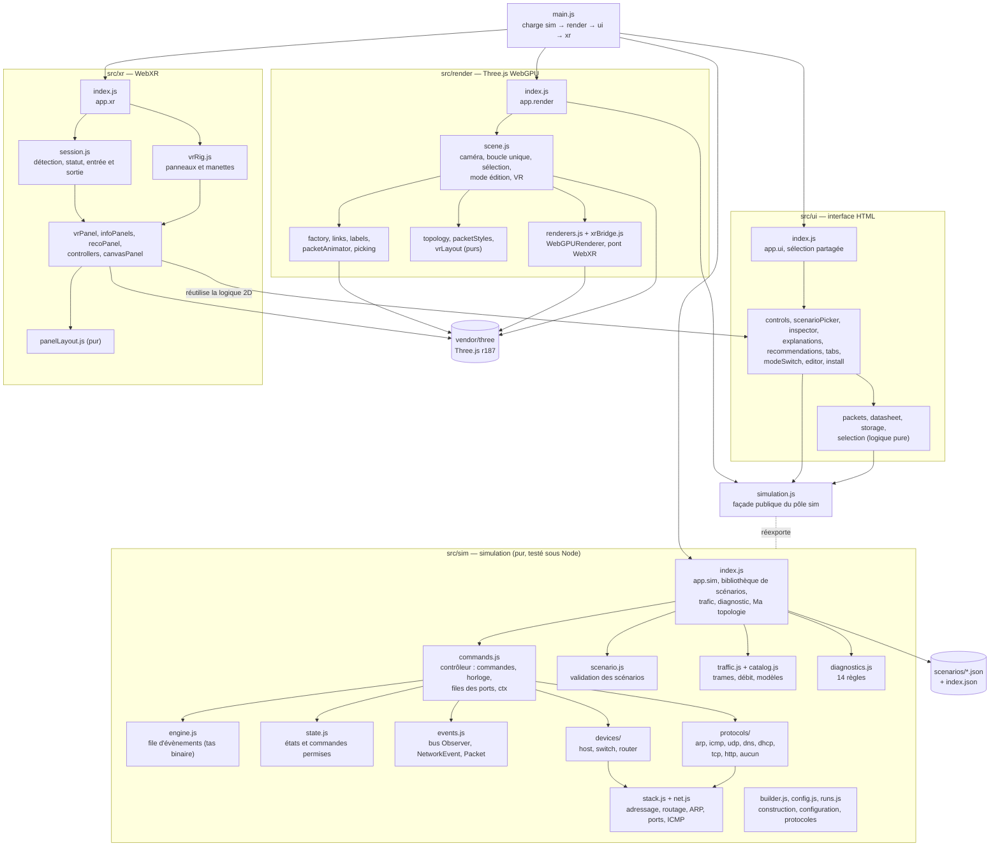
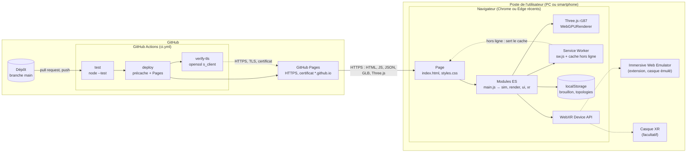
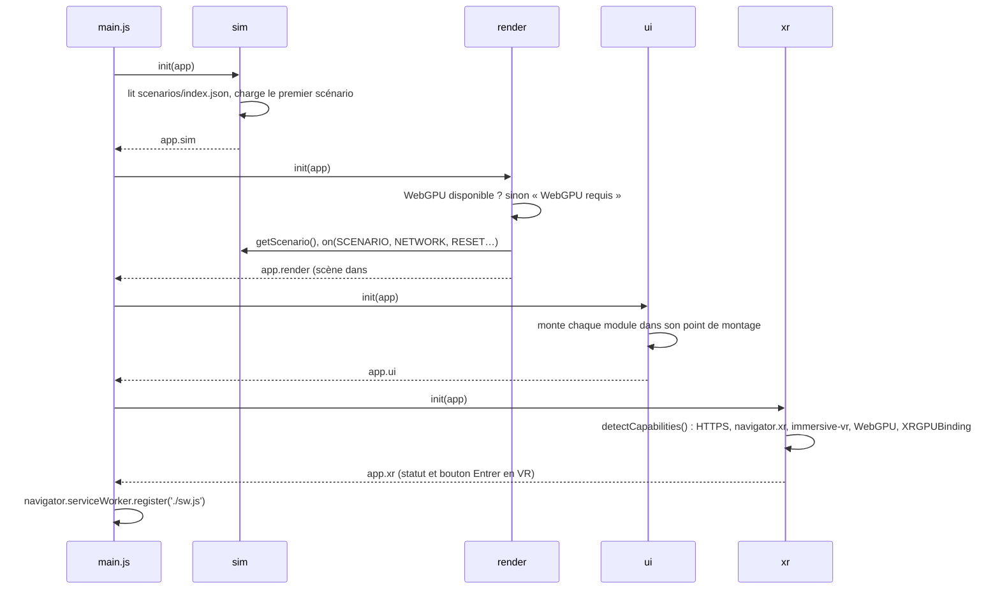
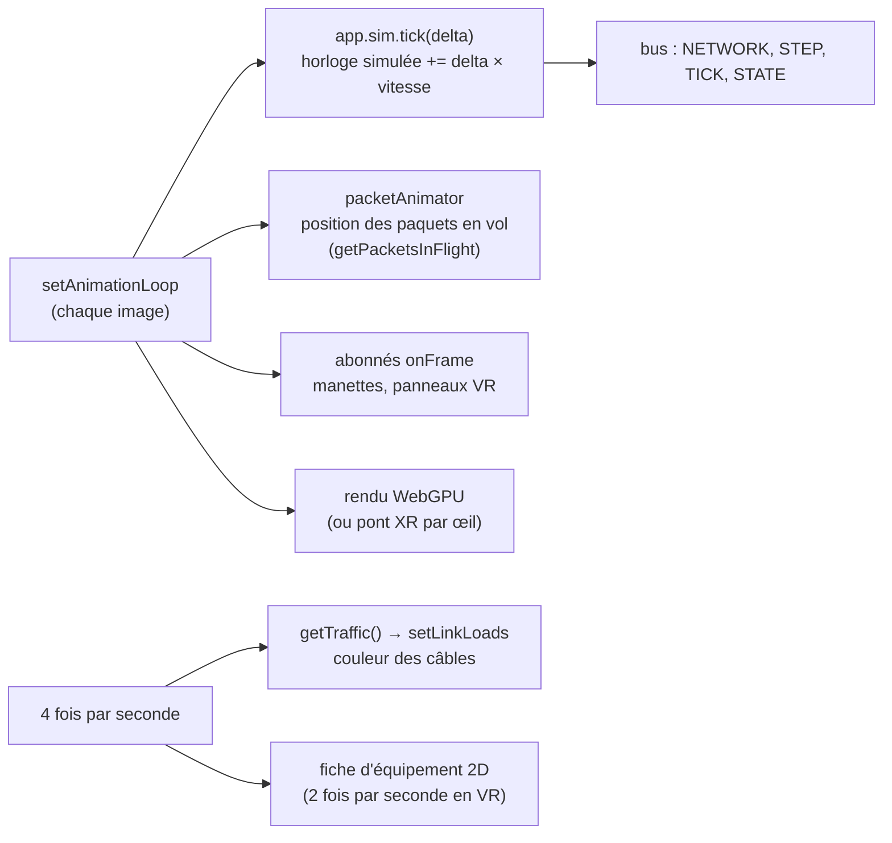
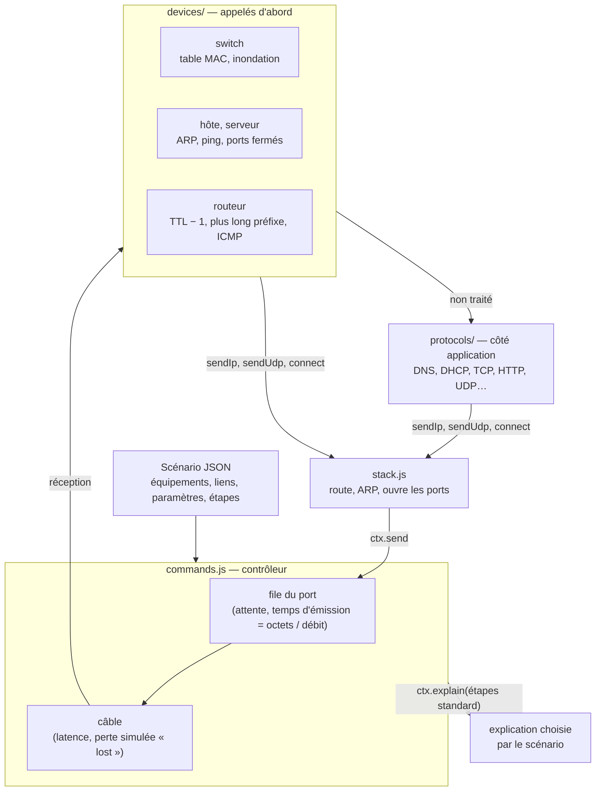
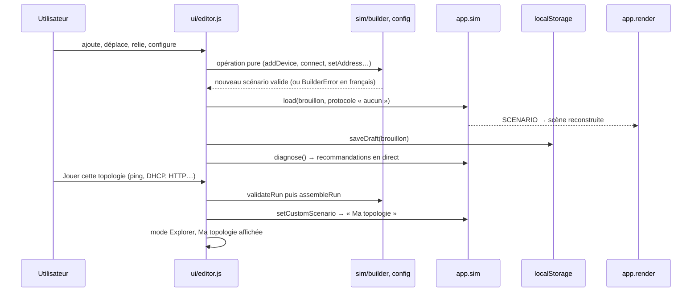

# Architecture

Version S1 rédigée par Khalil ; version finale réécrite à la phase 9 de la refonte (13 novembre 2026), d'après le code.
API détaillées entre pôles : [`simulation/contrats.md`](simulation/contrats.md). Diagrammes de cas d'utilisation, de séquence et de classes : [`cahier-conceptuel.md`](cahier-conceptuel.md).

## 1. Principes

1. **Site statique, sans serveur applicatif** : HTML, CSS et modules ES natifs servis tels quels par GitHub Pages. Aucune étape de build, aucune dépendance à l'exécution, aucun CDN ni URL externe : tout ce qui est chargé est dans le dépôt (Three.js copié dans `vendor/three/`), ce qui rend le hors ligne possible. Tous les chemins sont relatifs, car le site est servi sous `/3D-network-topology/`.
2. **Quatre pôles** (`sim`, `render`, `ui`, `xr`) qui ne se parlent que par des **contrats** : l'objet partagé `app` et le bus d'évènements du moteur.
3. **La simulation ne dépend pas de l'affichage.** Le moteur ne connaît ni Three.js, ni le DOM, ni le nombre d'images par seconde : il est déterministe et testé sous Node. Le rendu, l'interface et la VR observent ce qu'il publie.
4. **Logique pure séparée du DOM et de Three.js**, dans tous les pôles : `builder.js`, `diagnostics.js`, `datasheet.js`, `packets.js`, `panelLayout.js`, `vrLayout.js`, `packetStyles.js`… se testent sans navigateur ; les fichiers `mount`/`init` ne font que brancher cette logique sur la page ou la scène.
5. **Rendu 100 % WebGPU** (Three.js r187, `WebGPURenderer`) pour le PC, le mobile et la VR ; aucun contexte WebGL. Dans Immersive Web Emulator, la VR passe par le pont `src/render/xrBridge.js` ([`decision-renderer.md`](decision-renderer.md)).
6. **Dégradation propre** : un pôle qui ne se charge pas n'emporte pas les autres ; sans WebXR, le mode 2D reste complet ; sans scénario lisible, le moteur se replie sur une démonstration ; sans stockage local, l'éditeur propose l'export JSON.

## 2. Modules et dépendances

Règles de dépendance :

- Les pôles `render`, `ui` et `xr` n'importent du pôle `sim` que la **façade** `simulation.js` (constantes, catalogue, fonctions pures) ; tout le reste passe par `app.sim` et son bus.
- Le pôle `xr` **réutilise** la logique de l'interface 2D (`controlsView`, `describeSelection`, contrôleur des recommandations) : mêmes règles et mêmes données en 2D et en VR.
- Seuls `render` et `xr` importent Three.js ; `sim` et `ui` n'en dépendent pas, ce qui permet de les tester sous Node.
- `main.js` est figé : chaque pôle branche ses sous-modules dans son propre `index.js`.

## 3. Déploiement

- **HTTPS obligatoire** : WebXR, WebGPU et le Service Worker n'existent qu'en contexte sécurisé (`localhost` est accepté en développement). GitHub Pages impose HTTPS (redirection 301, HSTS) ; la CI le vérifie après chaque déploiement et chaque semaine ([`ci-cd.md`](ci-cd.md)).
- **Hors ligne** : à l'installation, le Service Worker met en cache la liste générée par `tools/build-precache.js` (`precache-manifest.js`, produit par la CI, non versionné), puis sert le cache d'abord. Une nouvelle version remplace l'ancienne à l'activation.
- **Rien côté serveur** : les topologies construites restent dans le navigateur (`localStorage`) ou dans un fichier JSON exporté.

## 4. Démarrage

`main.js` importe les quatre `index.js` dans un ordre fixe ; chacun reçoit l'objet `app` et y range son API publique. Chaque `init` est protégé : si un pôle échoue, les suivants se chargent quand même.

## 5. Boucle de rendu et horloge

Une **seule boucle**, `renderer.setAnimationLoop((time, xrFrame) => …)` dans `src/render/scene.js`, pilote tout, en mode classique comme en VR (où le `requestAnimationFrame` de la fenêtre est suspendu) :

- Le **temps simulé** avance de *durée réelle de l'image × vitesse* (durée bornée à 100 ms). Pause, pas à pas et vitesse restent cohérents quelle que soit la fluidité. Si personne n'appelle `tick` pendant 250 ms (tests sous Node, rendu en panne), une horloge interne prend le relais.
- **Échelle** : 1 s simulée = 1 ms de réseau (`SLOWDOWN = 1000`) : une trame de 1500 octets à 1 Gb/s dure 12 µs, soit 12 ms à l'écran.
- **Pas à pas** saute au prochain instant où il se passe quelque chose ; **Réinitialiser** vide la file et rejoue à l'identique.

## 6. Pile réseau simulée

- Les **équipements** (`src/sim/devices/`) font tout ce qui ne dépend pas du scénario ; les **protocoles** (`src/sim/protocols/`) n'agissent que par `ctx` (`send`, `drop`, `explain`, `schedule`, `memory`) : ni `setTimeout`, ni DOM, donc déterministes.
- Les protocoles se composent : HTTP utilise `resolveName` (DNS) puis `connect` (TCP) ; TCP gère séquences, ACK cumulatifs, fenêtre de 8000 octets, une temporisation de retransmission, FIN et RST.
- La configuration obtenue pendant l'exécution (DHCP) est gardée par la pile (`runtimeDevice`), jamais écrite dans le scénario : une réinitialisation rejoue à l'identique.
- Le **trafic** est mesuré à partir des envois (`traffic.js`) ; le **diagnostic** (`diagnostics.js`) lit le scénario, la configuration et ce trafic.

## 7. Éditeur (mode Construire)

Le brouillon **est** un scénario : la scène, les fiches, les débits et le diagnostic suivent la construction sans code supplémentaire, et l'export JSON a le format des scénarios fournis.

## 8. WebXR

- `src/xr/session.js` détecte la WebXR Device API, `immersive-vr` et `immersive-ar`, WebGPU et `XRGPUBinding` (sans jamais créer de contexte WebGL) et affiche **« WebXR détectée »** ou **« WebXR non détectée »** dans l'en-tête. **Entrer en VR** ouvre une session `immersive-vr` et la confie à `app.render.startXR(session)`.
- `src/render/renderers.js` crée l'unique `WebGPURenderer`. À l'entrée en VR, `xrBridge.js` choisit : `XRGPUBinding` du navigateur si la fonctionnalité `webgpu` est accordée, sinon (émulateur) un pont qui rend chaque œil en WebGPU et copie l'image dans un canevas que l'émulateur affiche.
- La topologie devient une **maquette** d'environ 1,5 m posée devant l'utilisateur (`vrLayout.js`), à une hauteur tirée de la pose du casque.
- `vrRig.js` crée à l'entrée, et détruit à la sortie, quatre panneaux dessinés sur des canevas : commandes, fiche de l'équipement, explication de l'étape, recommandations. `controllers.js` lit à chaque image la pose de visée des manettes, trace le rayon et, à la gâchette, presse le bouton visé ou sélectionne l'équipement (`pickDeviceHit` avec tolérance, puis `app.ui.select`).
- La vue classique (caméra, cible) est sauvegardée à l'entrée et rendue à la sortie.

## 9. Patrons de conception

| Patron | Où | Rôle |
| --- | --- | --- |
| **Observer** | `src/sim/events.js` (`createBus`) | Le moteur publie (`SCENARIO`, `NETWORK`, `STEP`, `TICK`, `STATE`, `RESET`) ; rendu, interface et VR s'abonnent sans que le moteur les connaisse. |
| **Command** | `src/sim/commands.js` | `play`, `pause`, `step`, `setSpeed`, `reset` : la même API sert aux boutons HTML, au clavier et au pupitre VR. |
| **State** | `src/sim/state.js` | États prêt, lecture, pause, terminé et commandes permises dans chacun (boutons actifs ou non). |
| **Strategy** | `src/sim/protocols/*.js`, `src/sim/devices/*.js` | Chaque protocole est une stratégie `{ start, onReceive, describe }` chargée d'après le scénario ; chaque type d'équipement a son comportement. |
| **Factory** | `src/render/factory.js` | Crée l'objet 3D (modèle GLB ou forme simple) adapté au type d'équipement. |
| **Façade** | `simulation.js`, `app.sim` | Un seul point d'entrée du pôle sim pour les autres pôles. |
| **Contrôleur partagé** | `src/ui/recommendations.js`, `controls.js` | La même logique sert la vue HTML et le panneau VR. |
| **Fonctions pures + état immuable** | `builder.js`, `config.js` | Chaque opération de l'éditeur renvoie un nouveau scénario validé : annuler une erreur ne laisse jamais de topologie à moitié modifiée. |

## 10. Tests

393 tests (`node --test`, sans navigateur), à 0 échec à la phase 8.

| Pôle | Fichiers | Ce qui est vérifié |
| --- | --- | --- |
| sim | `tests/engine`, `events`, `state`, `commands`, `scenario`, `protocol`, `mock` | Ordre et déterminisme, bus, transitions, commandes, validation, interface des protocoles |
| réseau | `tests/net`, `arp`, `icmp`, `routage`, `switch`, `host`, `router`, `udp`, `dns`, `dhcp`, `tcp`, `http` | Séquence de messages de chaque protocole et comportement de chaque équipement |
| débit, diagnostic, éditeur | `tests/catalog`, `traffic`, `diagnostics`, `builder`, `runs` | Temps d'émission, files, saturation ; une faute injectée par règle ; réseau construit de zéro puis joué avec les 9 protocoles |
| render | `src/render/*.test.mjs` | Topologie, styles des paquets, placement VR, renderer WebGPU (aucun WebGL dans `src/`), pont XR |
| ui | `src/ui/*.test.js` | Montage, commandes, inspecteur, fiches, journal, recommandations, éditeur, stockage, installation |
| xr | `src/xr/session.test.js`, `vr.test.js` | Statuts de détection, panneaux, mise en page, visée |
| plateforme | `tests/platform`, `sw`, `ci`, `tools/*.test.js` | Chemins relatifs, aucun CDN, Service Worker, précache, icônes, pipeline CI |

Les fonctionnalités visibles sont aussi vérifiées dans Chrome piloté par script (mode classique, largeur mobile, VR avec IWER, hors ligne, console vide) : voir [`avancement.md`](avancement.md).

## 11. Contraintes et réponses

| Contrainte ou risque | Réponse |
| --- | --- |
| WebXR, WebGPU et Service Worker exigent HTTPS | GitHub Pages en HTTPS, vérifié par la CI ; `localhost` en développement |
| Site servi sous `/<dépôt>/` | Chemins relatifs partout, vérifiés par `tests/platform.test.js` |
| Hors ligne impossible avec un CDN | Three.js dans `vendor/three/` ; liste de précache générée par la CI |
| Émulateur VR sans WebGPU | Pont `xrBridge.js` : 0 contexte WebGL, même renderer en 2D et en VR. Fragile : dépend du fonctionnement interne de Three.js r187 et d'IWER |
| HTML invisible en VR | Panneaux 3D qui réutilisent la logique de l'interface 2D |
| Paquets trop rapides pour être vus | Échelle de temps × 1000, vitesse réglable de ×0,25 à ×4 |
| Tempête de diffusion sur une boucle | Boucle de commutation détectée par le diagnostic ; la lecture est bloquée dans l'éditeur |
| Performances mobiles | Géométries et matériaux partagés, journal limité à 400 lignes, mises à jour des fiches 2 à 4 fois par seconde |
