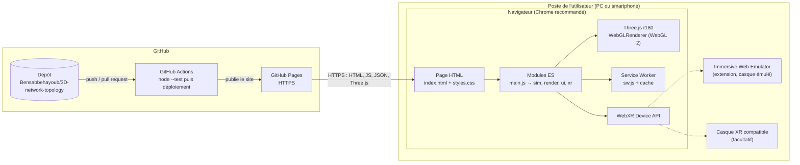
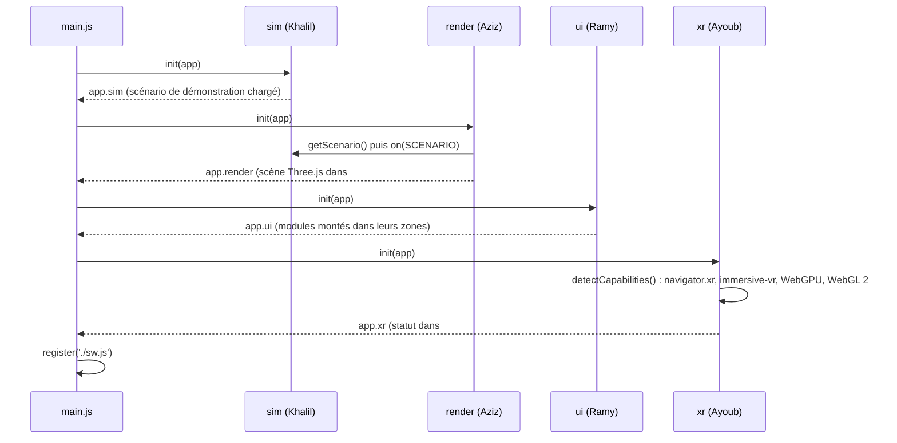
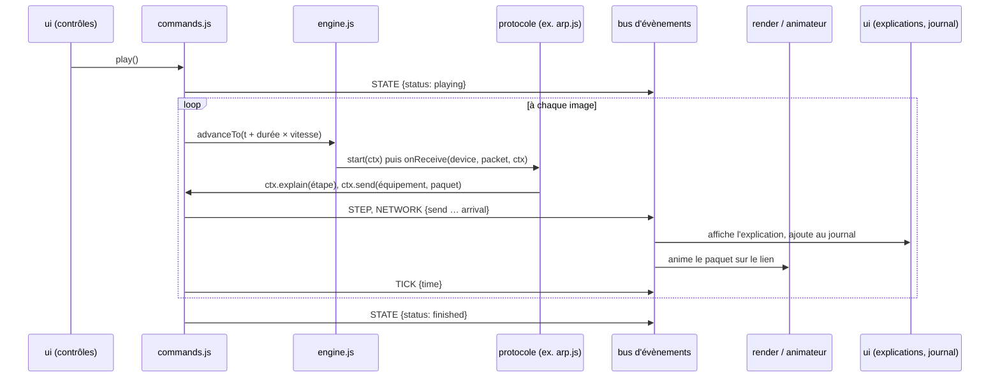

# Architecture

Auteur : Khalil. Version S1, complétée au fil des sprints (version finale : S7).
Contrats détaillés entre pôles : [`simulation/contrats.md`](simulation/contrats.md).

## 1. Principes

1. **Site statique, sans backend** : HTML, CSS et modules JavaScript servis tels quels par GitHub Pages. Aucune étape de build, aucune dépendance CDN : tout ce qui est chargé est dans le dépôt, ce qui rend le hors ligne possible.
2. **Quatre pôles indépendants** (sim, render, ui, xr), un propriétaire chacun. Ils ne se parlent que par des **contrats figés en S1**, et chacun fournit un **mock** pour que les autres avancent sans l'attendre.
3. **La simulation ne dépend pas de l'affichage.** Le moteur ne connaît ni Three.js, ni le DOM, ni le nombre d'images par seconde : il est déterministe et testé sous Node. Le rendu et l'interface ne font qu'observer ce qu'il publie.
4. **Une seule voie de rendu** (Three.js `WebGLRenderer`, WebGL 2) pour le PC, le mobile et la VR ([`decision-renderer.md`](decision-renderer.md)).
5. **Dégradation propre** : un pôle qui ne se charge pas n'emporte pas les autres ; sans WebXR, le mode 2D reste complet.

## 2. Diagramme de déploiement

HTTPS est obligatoire en production : WebXR et le Service Worker ne fonctionnent qu'en contexte sécurisé (`localhost` est accepté pour le développement). Le site est servi sous `/<nom-du-dépôt>/`, donc **tous les chemins sont relatifs** (`./sw.js`, `start_url: "./"`), ce que vérifie `tests/platform.test.js`.

## 3. Démarrage de l'application

`main.js` importe les quatre `index.js` dans un ordre fixe. Chaque pôle reçoit l'objet partagé `app` et y range son API publique.

Chaque `init` est protégé par un `try/catch` : si un pôle échoue, les suivants se chargent quand même.

## 4. Pendant une simulation

- Le **temps simulé** (en ms) avance de *durée réelle de l'image × vitesse*. Pause, pas à pas et vitesse restent donc cohérents quelle que soit la fluidité de l'affichage.
- **Pas à pas** saute directement au prochain instant où il se passe quelque chose.
- **Réinitialiser** vide la file, remet l'horloge à 0 et rejoue le scénario à l'identique.
- La file d'évènements est un **tas binaire** trié par (instant, ordre de programmation) : insertion et retrait en O(log n), ordre stable à instant égal. Une action programmée peut être **annulée** (temporisation TCP quand l'ACK arrive à temps).
- Le moteur garde l'**historique** de l'exécution et la liste des **paquets en vol** : l'animateur et le journal peuvent se reconstruire à tout instant (`getPacketsInFlight()`, `getHistory()`).

## 5. Patrons de conception (cahier §8.2)

| Patron | Où | Rôle |
| --- | --- | --- |
| **Observer** | `src/sim/events.js` (`createBus`) | Le moteur publie ; le rendu, l'interface et la VR s'abonnent sans que le moteur les connaisse. |
| **Command** | `src/sim/commands.js` | `play`, `pause`, `step`, `setSpeed`, `reset` : la même API sert aux boutons HTML et au panneau VR. |
| **State** | `src/sim/state.js` | États prêt, lecture, pause, terminé et commandes permises dans chacun (active ou désactive les boutons). |
| **Strategy** | `src/sim/protocols/*.js` | Chaque protocole est une stratégie interchangeable `{ start, onReceive, describe }`, chargée d'après le scénario. |
| **Factory** | `src/render/factory.js` (S2) | Crée l'objet 3D adapté au type d'équipement décrit dans le JSON. |

## 6. WebXR

- `src/xr/session.js` détecte la WebXR Device API (`navigator.xr`), teste `isSessionSupported('immersive-vr')` et `'immersive-ar'`, et détecte aussi WebGL 2 et WebGPU. Le résultat s'affiche dans `#xr-slot` : **« WebXR détectée »** (point vert si la VR est disponible, orange sinon) ou **« WebXR non détectée »** (point rouge, mode 2D), avec le détail au clic.
- Le bouton **Entrer en VR** ouvre une session `immersive-vr` (`local-floor` facultatif) et la confie au rendu par `app.render.startXR(session)`.
- `src/render/scene.js` active `renderer.xr` et pilote tout par une **boucle d'animation unique**, `renderer.setAnimationLoop((time, xrFrame) => …)` : rendu, horloge de la simulation (`app.sim.tick(delta)`) et abonnés `onFrame`. C'est la seule boucle qui continue en VR, où le `requestAnimationFrame` de la fenêtre est suspendu.
- Pendant la session, la topologie devient une maquette d'environ 1,5 m posée devant l'utilisateur (`src/render/vrLayout.js`). Sa hauteur vient de la pose du casque, lue dans le `XRFrame` (`getViewerPose(espace de référence)`).
- Les panneaux HTML disparaissent en VR. `src/xr/vrRig.js` crée à l'entrée, et détruit à la sortie, trois panneaux 3D dessinés sur des canvas : commandes (`vrPanel.js`, mêmes règles que la barre HTML), fiche de l'équipement sélectionné et explication de l'étape (`infoPanels.js`).
- `src/xr/controllers.js` lit à chaque image la pose de visée de chaque manette (`xrFrame.getPose(inputSource.targetRaySpace, espace de référence)`), trace le rayon jusqu'à sa cible, et sur l'évènement `select` (gâchette) presse le bouton visé ou sélectionne l'équipement visé (`app.render.pickDeviceHit`, puis `app.ui.select(id)`).

## 7. Tests

| Pôle | Fichiers | Ce qui est vérifié |
| --- | --- | --- |
| sim | `tests/engine`, `events`, `scenario`, `state`, `commands`, `protocol`, `mock` | Ordre et déterminisme du moteur, bus, validation des scénarios, transitions d'état, commandes, contexte des protocoles, faux moteur |
| render | `src/render/topology.test.mjs` | Lecture de la topologie, rejets (doublons, liens orphelins), mock de rendu |
| ui | `src/ui/index.test.js` | Montage des modules, points de montage, absence de ressources externes |
| xr | `src/xr/session.test.js` | Statuts « détectée / non détectée », HTTPS requis, erreurs de détection |
| plateforme | `tests/platform.test.js` | Chemins relatifs du manifest et de `main.js`, absence de CDN |

Lancement : `node --test`. La CI les exécute à chaque pull request ; une PR qui casse un test ne peut pas être fusionnée.

## 8. Contraintes et risques suivis

| Contrainte ou risque | Réponse |
| --- | --- |
| WebXR et Service Worker exigent HTTPS | GitHub Pages en HTTPS ; `localhost` en développement ; le statut WebXR signale un contexte non sécurisé |
| Chemins sous `/<dépôt>/` sur Pages | Chemins relatifs partout, vérifiés par un test |
| Hors ligne impossible avec un CDN | Three.js copié dans `vendor/three/` ; liste de précache générée par la CI (S2, S6) |
| WebGPU sans VR dans l'émulateur | Voie unique WebGL 2 ; WebGPU détecté et affiché, non utilisé |
| HTML invisible en VR | Panneau de commandes 3D (S4) qui appelle la même API de commandes |
| Performances mobiles | Géométries et matériaux partagés, peu de paquets simultanés (S5) |
