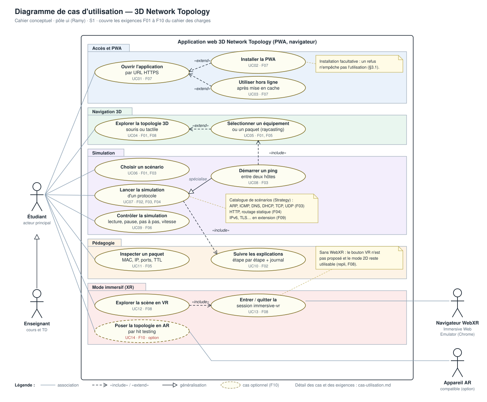
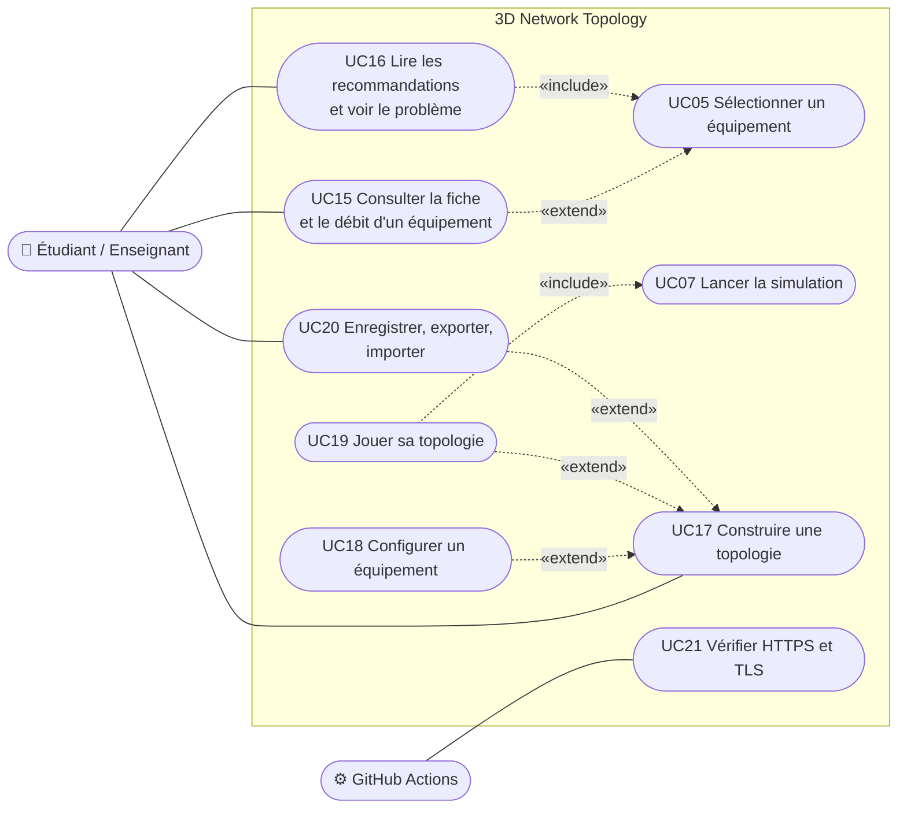
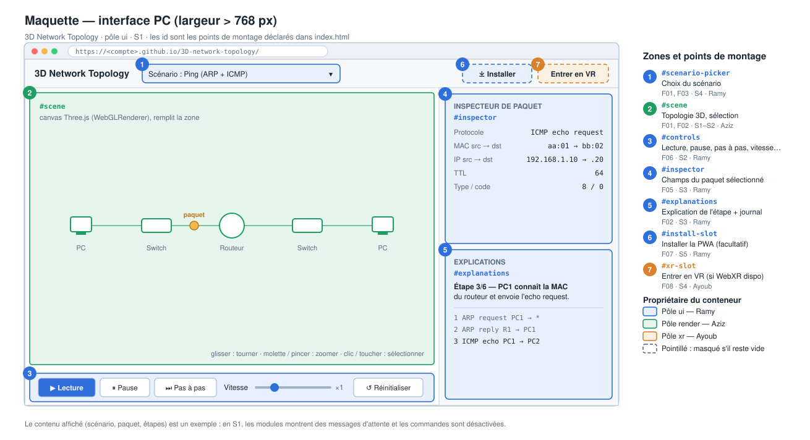
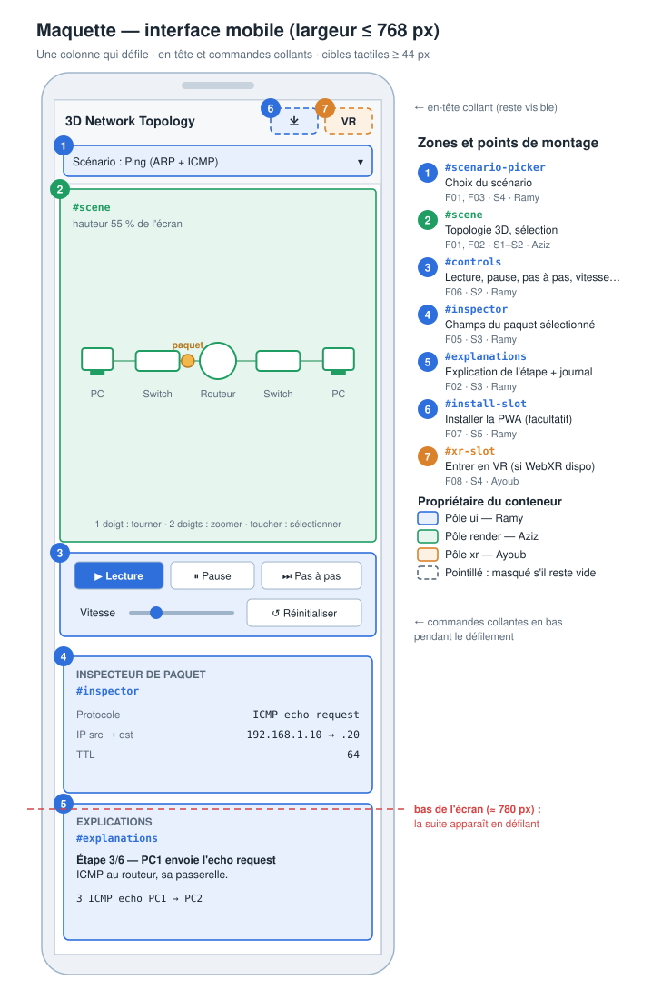
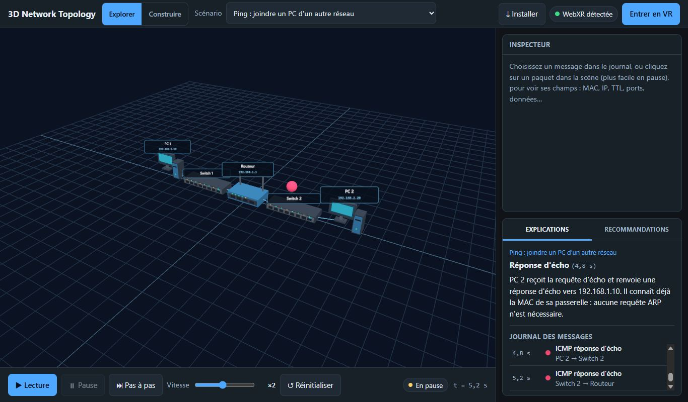
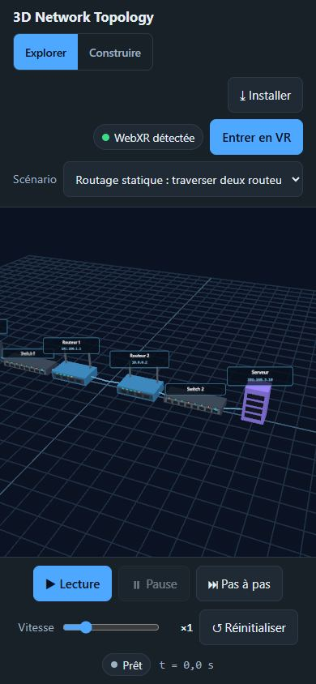
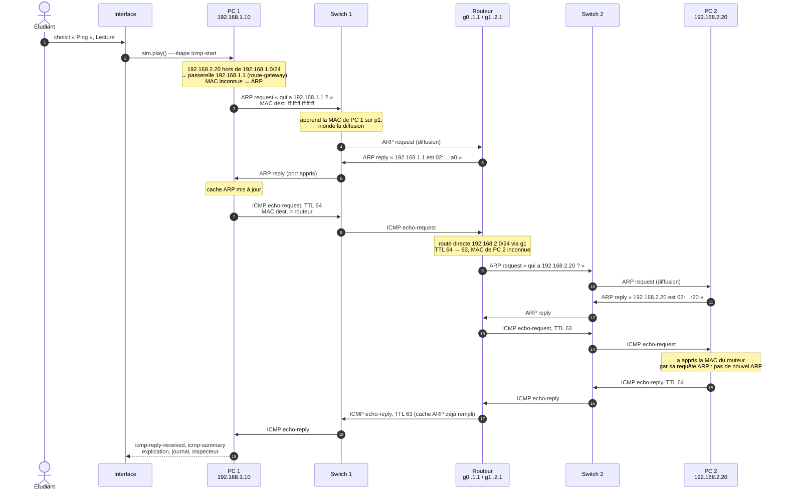
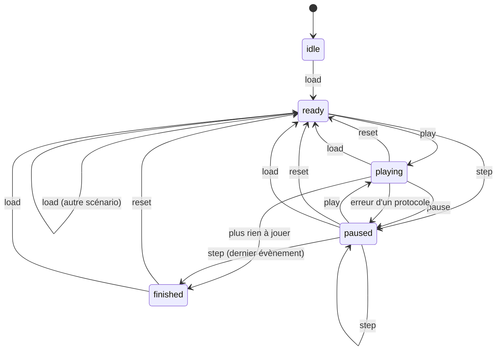
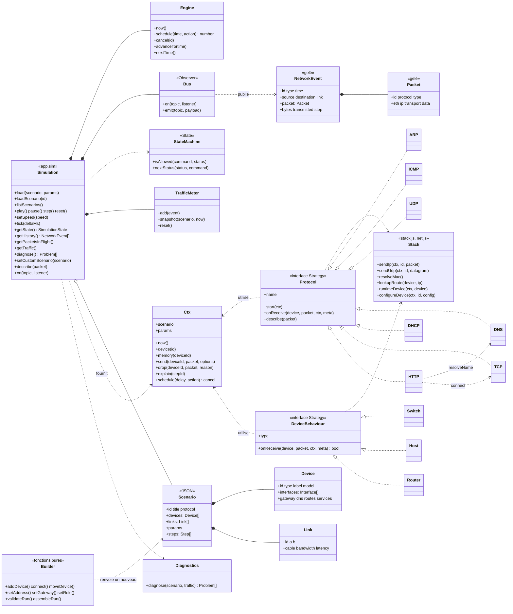
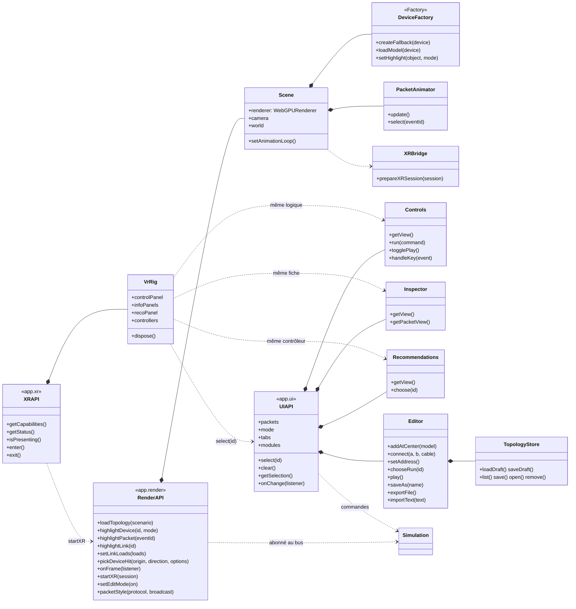

# Cahier conceptuel

Assemblé par Ramy. Version S1 : besoins, cas d'utilisation, maquettes, contrats. Version finale (refonte, phase 9a, 13 novembre 2026) : cas d'utilisation complétés, diagrammes de déploiement, de séquence, d'états et de classes établis d'après le code.

| Livrable (cahier des charges §4) | État | Où |
| --- | --- | --- |
| Besoins fonctionnels F01–F10 | ✅ S1, états mis à jour | [section 1](#1-besoins) |
| Maquettes de l'interface (PC et mobile) | ✅ S1 (Ramy) ; captures finales | [section 3](#3-maquettes-et-interface-réalisée) |
| Diagramme de cas d'utilisation | ✅ S1 (Ramy), complété en 9a | [section 2](#2-cas-dutilisation), [`conception/cas-utilisation.md`](conception/cas-utilisation.md) |
| Diagramme de déploiement | ✅ S1 (provisoire), final en 9a | [section 4](#4-déploiement), [`architecture.md` §3](architecture.md#3-déploiement) |
| Diagramme de séquence du ping | ✅ 9a, relevé sur le moteur | [section 5](#5-séquence-du-ping) |
| Diagramme d'états de la simulation | ✅ 9a | [section 6](#6-états-de-la-simulation) |
| Diagramme de classes | ✅ 9a | [section 7](#7-classes) |
| Contrats entre modules | ✅ S1 (Khalil), tenus à jour à chaque phase | [`simulation/contrats.md`](simulation/contrats.md) |
| Choix du moteur de rendu | ✅ S1 (Ayoub), refait en phase 2 (100 % WebGPU) | [`decision-renderer.md`](decision-renderer.md) |

## 1. Besoins

**Utilisateurs.** Primaires : étudiants du cycle ingénieur qui étudient les réseaux. Secondaires : enseignants (cours et TD). Évaluation : superviseur et jury.

**Besoin pédagogique.** Chaque scénario présente le rôle du protocole, les équipements impliqués, la succession des messages et leur interprétation. Le projet simule les échanges pour apprendre ; il ne reproduit pas une pile réseau complète (simplifications indiquées dans les [fiches des protocoles](protocoles/)).

**Besoin d'accès.** URL HTTPS sans configuration ; installation PWA facultative ; utilisation hors ligne après un premier chargement ; mode classique (souris, tactile) et mode VR (WebXR, émulable).

| Réf. | Fonctionnalité | Priorité | Cas d'utilisation | État |
| --- | --- | --- | --- | --- |
| F01 | Charger une topologie JSON et l'explorer en 3D | Essentiel | UC04, UC05, UC06, UC17, UC20 | ✅ |
| F02 | Animations et explications étape par étape | Essentiel | UC07, UC10 | ✅ |
| F03 | ARP, ICMP, DNS, DHCP, TCP, UDP | Prioritaire | UC07, UC08 | ✅ |
| F04 | HTTP, routage statique (VLAN si le temps le permet) | Progressif | UC07 | ✅ HTTP et routage ; VLAN non réalisé |
| F05 | Inspection des paquets | Essentiel | UC11 | ✅ |
| F06 | Lecture, pause, pas à pas, vitesse, réinitialisation | Essentiel | UC09 | ✅ |
| F07 | Accès par URL, PWA, cache | Essentiel | UC01, UC02, UC03 | ✅ |
| F08 | Mode classique et VR WebXR | Essentiel | UC04, UC12, UC13 | ✅ |
| F09 | Extensions (IPv6, TLS, OSPF…) | Extension | UC07 | Non réalisé |
| F10 | AR par hit testing | Option | UC14 | Non réalisé |
| — | Caractéristiques des équipements et débit (demande du superviseur) | Refonte | UC15 | ✅ |
| — | Diagnostic et recommandations (demande du superviseur) | Refonte | UC16 | ✅ |
| — | Éditeur de topologie (demande du superviseur) | Refonte | UC17 à UC20 | ✅ |
| — | Vérification HTTPS et TLS du site (demande du superviseur) | Refonte | UC21 | ✅ |

## 2. Cas d'utilisation

Le diagramme de S1 (UC01 à UC14) reste valable :

Cas ajoutés par la refonte :

Description de tous les cas (UC01 à UC21) et correspondance avec le plan de démonstration : [`conception/cas-utilisation.md`](conception/cas-utilisation.md).

## 3. Maquettes et interface réalisée

Maquettes de S1 :

| PC | Mobile |
| --- | --- |
|  |  |

Interface réalisée (la disposition des maquettes est conservée : scène au centre, barre de lecture dessous, inspecteur et explications à droite, colonne unique sur mobile) :

| PC | Mobile |
| --- | --- |
|  |  |

## 4. Déploiement

Diagramme final et explications : [`architecture.md` §3](architecture.md#3-déploiement). En résumé : le dépôt est testé puis publié par GitHub Actions sur GitHub Pages (HTTPS) ; le navigateur charge des fichiers statiques, les met en cache par le Service Worker, affiche la scène en WebGPU et ouvre la session VR par la WebXR Device API (casque réel ou Immersive Web Emulator) ; les topologies construites restent dans le navigateur.

## 5. Séquence du ping

Scénario `ping.json` : PC 1 (192.168.1.10/24) → Switch 1 → Routeur (g0 192.168.1.1, g1 192.168.2.1) → Switch 2 → PC 2 (192.168.2.20/24). Séquence **relevée en exécutant le moteur** (un seul ping, caches ARP vides). Chaque message met environ 400 ms simulées par câble.

Les étapes expliquées dans l'ordre : `icmp-start`, `icmp-request-1`, `route-gateway`, `arp-request-pc1`, `arp-reply-r1`, `arp-cache-update-pc1`, `router-forward-r1`, `arp-request-r1`, `arp-reply-pc2`, `icmp-reply-pc2`, `icmp-reply-received-1`, `icmp-summary`. Le scénario fourni envoie deux pings : le second ne fait plus d'ARP (caches remplis), ce que l'explication fait remarquer.

## 6. États de la simulation

Patron State (`src/sim/state.js`) : une commande non permise renvoie `false` et le bouton correspondant est désactivé, en 2D comme sur le pupitre VR.

## 7. Classes

Le code est écrit en modules ES avec des **fonctions de fabrique** (`createSimulation`, `createBus`, `createTrafficMeter`…) plutôt qu'avec le mot-clé `class` : chaque « classe » du diagramme est l'objet renvoyé par sa fabrique, ou un format de données (scénario, paquet, évènement) validé par une fonction. Les noms de méthodes sont ceux du code.

### Simulation

### Rendu, interface et VR

Patrons utilisés (Observer, Command, State, Strategy, Factory, Façade) et leur rôle : [`architecture.md` §9](architecture.md#9-patrons-de-conception).
