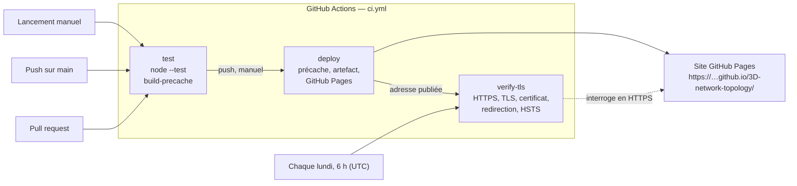

# Intégration et déploiement continus (CI/CD), HTTPS et TLS

Le site est publié sur **GitHub Pages** :
<https://bensabbehayoub.github.io/3D-network-topology/>. Tout est décrit dans un seul fichier,
[`.github/workflows/ci.yml`](../.github/workflows/ci.yml), exécuté par GitHub Actions.

## Pipeline



| Job | Quand | Rôle |
| --- | --- | --- |
| `test` | pull request, push sur `main`, lancement manuel | `node --test` (toute la suite, sans navigateur) puis `node tools/build-precache.js` (la liste des fichiers mis en cache hors ligne doit se générer). Un échec est signalé dans la pull request (pour l'imposer avant toute fusion, déclarer ce job comme vérification obligatoire dans les règles de protection de `main`). |
| `deploy` | push sur `main`, lancement manuel, après `test` | Génère `precache-manifest.js` (non versionné), publie le dépôt comme site statique (`configure-pages`, `upload-pages-artifact`, `deploy-pages`) et transmet l'adresse publiée au job suivant. |
| `verify-tls` | après un déploiement réussi, et chaque lundi | Lance [`tools/verify-tls.sh`](../tools/verify-tls.sh) sur l'adresse publiée : réponse HTTPS (jusqu'à 10 essais à 15 s d'intervalle, le temps que Pages publie), `openssl s_client` (version TLS, suite de chiffrement, échange de clés, vérification du certificat), certificat (sujet, émetteur, dates), TLS 1.2, redirection HTTP → HTTPS, en-tête HSTS. Résumé en tableau dans la page de l'exécution. **Échoue** si le site ne répond pas en HTTPS ou si le certificat est invalide ou expiré ; **avertit** s'il expire dans moins de 14 jours, sans redirection ou sans HSTS. |

Autres réglages :

- `concurrency` : un nouveau push annule l'exécution en cours sur la même branche ;
- `permissions` : lecture seule par défaut ; seul `deploy` peut écrire sur Pages (`pages: write`,
  `id-token: write`) ;
- la vérification hebdomadaire surveille le certificat entre deux déploiements (un certificat
  Let's Encrypt dure 90 jours) ;
- versions des actions vérifiées le 13 novembre 2026 : `checkout@v7`, `setup-node@v7`,
  `configure-pages@v6`, `upload-pages-artifact@v5`, `deploy-pages@v5` (contrôlées par
  `tests/ci.test.js`).

**Seule la branche `main` est publiée.** Une branche de travail (comme `feature/refonte-prof`)
passe les tests à chaque pull request, mais n'est en ligne qu'après sa fusion dans `main`.

Lancer la vérification sur un poste (Git Bash sous Windows, Linux ou macOS) :

```
bash tools/verify-tls.sh https://bensabbehayoub.github.io/3D-network-topology/
```

## HTTPS et TLS sur GitHub Pages

### Ce que GitHub Pages impose

- **HTTPS obligatoire** pour les sites en `*.github.io` : une requête en `http://` reçoit une
  redirection **301** vers `https://`.
- **Certificat géré par GitHub** : un certificat générique `*.github.io`, renouvelé
  automatiquement (90 jours de validité). Il n'est ni fourni ni renouvelé par l'équipe.
- **HSTS** (`Strict-Transport-Security`) : le navigateur retient pendant un an qu'il ne faut plus
  jamais passer par HTTP pour ce site.

### Valeurs observées (13 novembre 2026)

Mesurées avec `tools/verify-tls.sh` sur `bensabbehayoub.github.io` :

| Élément | Valeur observée | Ce que cela signifie |
| --- | --- | --- |
| Version | **TLS 1.3** | Poignée de main en un aller-retour ; anciennes suites et chiffrements faibles supprimés de la norme. |
| Suite de chiffrement | **TLS_AES_128_GCM_SHA256** | Chiffrement authentifié AES-128 en mode GCM (confidentialité et intégrité), SHA-256 pour la dérivation des clés. |
| Échange de clés | **X25519** (253 bits) | Diffie-Hellman sur courbe elliptique, éphémère : une clé de session neuve à chaque connexion (confidentialité persistante : voler plus tard la clé du serveur ne déchiffre pas les échanges passés). |
| Certificat | `CN=*.github.io`, signature RSA-PSS | Certificat générique : il couvre tous les sites `*.github.io` (et aussi `github.com`, `githubusercontent.com`, d'après son champ *Subject Alternative Name*). |
| Émetteur | **Let's Encrypt** (`CN=YR1`) | Autorité de certification reconnue par les navigateurs ; vérification OpenSSL : `OK`. |
| Validité | du 30 septembre au **29 décembre 2026** | 90 jours ; 46 jours restants au moment de la mesure. |
| TLS 1.2 | accepté : `ECDHE-RSA-CHACHA20-POLY1305` | Compatibilité avec les clients plus anciens, toujours avec échange de clés éphémère. |
| HTTP → HTTPS | **301** vers `https://…` | Pas de page servie en clair. |
| HSTS | `max-age=31556952` (un an) | Le navigateur force HTTPS de lui-même. |

TLS 1.0 et 1.1 n'ont pas pu être testés : l'OpenSSL 3.2 du poste de test refuse lui-même ces
versions (« no protocols available » est une erreur du client, pas du serveur). Les navigateurs
les ont abandonnées depuis 2020.

Ces valeurs dépendent de GitHub et peuvent changer : l'exécution hebdomadaire de `verify-tls` en
garde la trace dans le journal.

### Le montrer en démonstration

1. **Dans Chrome** : ouvrir le site, F12, onglet **Sécurité** (*Security*). La section
   *Connection* affiche le protocole (TLS 1.3), l'échange de clés (X25519) et le chiffrement
   (AES_128_GCM) ; *View certificate* montre le sujet, l'émetteur et les dates. Le cadenas à
   gauche de l'adresse → « La connexion est sécurisée » → certificat, donne les mêmes informations.
2. **Dans un terminal** :

   ```
   openssl s_client -connect bensabbehayoub.github.io:443 -servername bensabbehayoub.github.io -brief < /dev/null
   ```

   affiche la version, la suite de chiffrement, l'échange de clés et le résultat de la vérification
   (`-servername` envoie le nom du site, indispensable quand un même serveur héberge de nombreux
   sites : SNI). Pour le certificat :

   ```
   openssl s_client -connect bensabbehayoub.github.io:443 -servername bensabbehayoub.github.io < /dev/null 2>/dev/null | openssl x509 -noout -subject -issuer -dates
   ```

   et pour la redirection et HSTS : `curl -sI http://bensabbehayoub.github.io/3D-network-topology/`
   puis `curl -sI https://bensabbehayoub.github.io/3D-network-topology/`.
3. **Dans GitHub** : onglet *Actions* → une exécution → job `verify-tls` : journal détaillé et
   tableau récapitulatif.

### Ce qui n'est pas configurable sur GitHub Pages

- **Le certificat** : impossible d'installer le sien sur `*.github.io`. Avec un nom de domaine
  personnel, GitHub en obtient un automatiquement (case *Enforce HTTPS*), sans plus de choix.
- **Les versions de TLS et les suites de chiffrement** : fixées par GitHub pour tous les sites.
- **HSTS** : durée, `includeSubDomains` et `preload` décidés par GitHub.
- **Les en-têtes HTTP** : pas de `Content-Security-Policy`, `X-Frame-Options` ou `Permissions-Policy`
  personnalisés (une politique CSP peut seulement être déclarée par une balise `<meta>` dans la
  page) ; pas de règles de cache par fichier (d'où le Service Worker pour le hors ligne).
- **Le serveur** : site statique, aucun code côté serveur ni redirection personnalisée.

## Limites

- La suite de tests tourne en CI sous **Node 22** ; elle est développée sous Node 25. Aucune
  fonction propre aux versions récentes n'est utilisée (vérifié dans le code), mais seule la
  première exécution en CI le confirme.
- `verify-tls` interroge le vrai site : il dépend du réseau de GitHub Actions et de la
  disponibilité de GitHub Pages.
