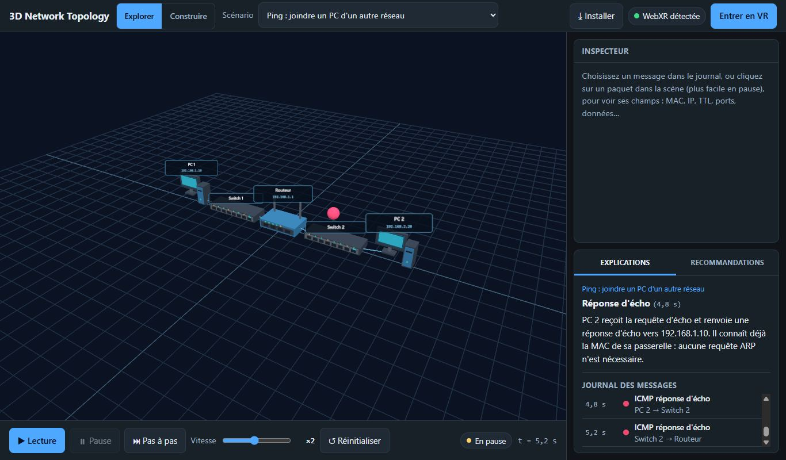
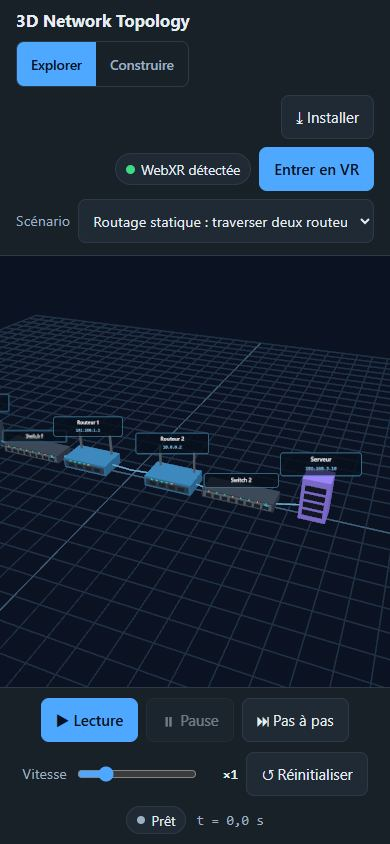
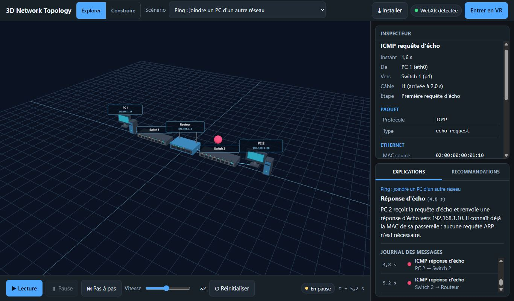
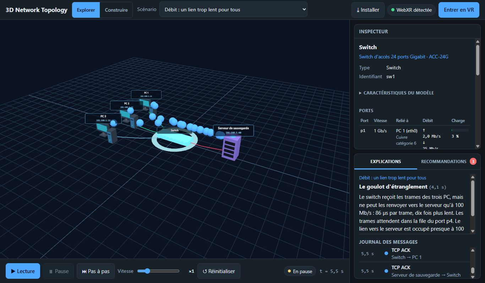
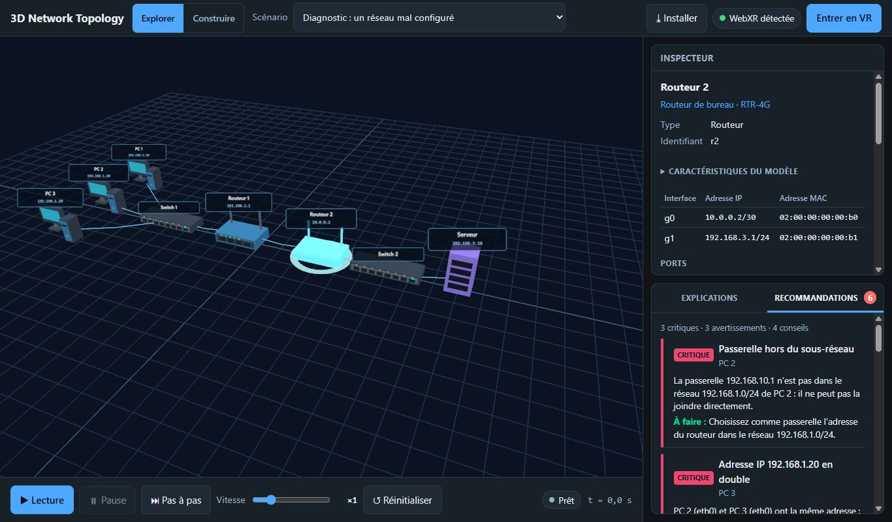
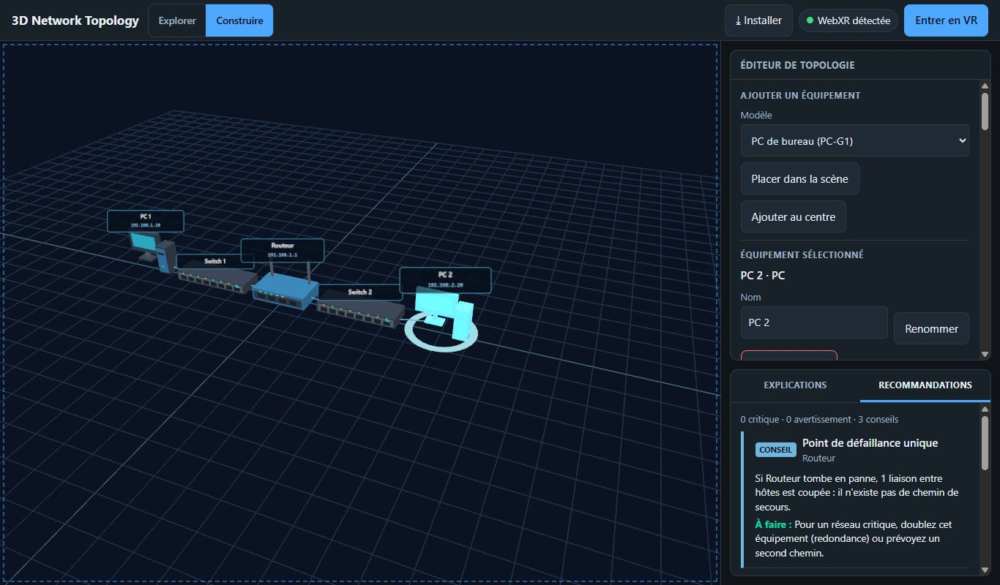
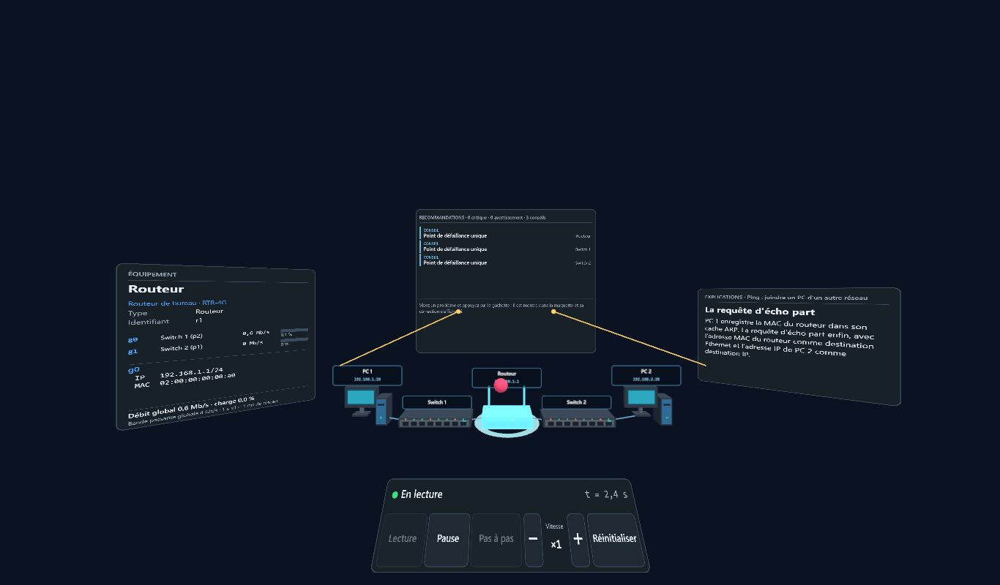

# Manuel utilisateur

Rédaction : Ramy. Version finale (13 novembre 2026) : elle décrit l'application telle qu'elle fonctionne à la fin de la refonte.

Sommaire : [ouvrir](#1-ouvrir-lapplication) · [l'écran](#2-lécran) · [explorer la scène](#3-explorer-la-scène) · [jouer un scénario](#4-jouer-un-scénario) · [inspecter un paquet](#5-inspecter-un-paquet) · [fiche d'équipement et débit](#6-fiche-déquipement-et-débit) · [recommandations](#7-recommandations) · [construire sa topologie](#8-construire-sa-topologie) · [réalité virtuelle](#réalité-virtuelle) · [installer, hors ligne](#10-installer-lapplication-et-lutiliser-hors-ligne) · [FAQ et dépannage](#11-faq-et-dépannage)

## 1. Ouvrir l'application

1. Ouvrir **https://bensabbehayoub.github.io/3D-network-topology/** dans **Chrome ou Edge récents**, sur PC ou smartphone.
2. Rien à installer : la page charge la topologie 3D et le premier scénario (ARP).

L'application a besoin de **WebGPU** pour la 3D : sans lui, la zone de la scène affiche « WebGPU requis ». Firefox et Safari ne l'activent pas encore partout.

## 2. L'écran

| Zone | Rôle |
| --- | --- |
| En-tête, à gauche | Titre, bascule **Explorer \| Construire**, liste des **scénarios** |
| En-tête, à droite | Statut **WebXR** et bouton **Entrer en VR** ; bouton **Installer** ; badge **Hors ligne** quand le réseau manque |
| Centre | Scène 3D : PC, switches, routeurs, serveurs, câbles et étiquettes (nom, adresse IP) |
| Sous la scène | Barre de lecture : Lecture, Pause, Pas à pas, vitesse, Réinitialiser, temps simulé |
| Panneau de droite, en haut | **Inspecteur** (équipement ou paquet sélectionné) ; en mode Construire, **Éditeur** |
| Panneau de droite, en bas | Onglets **Explications** (étape en cours et journal) et **Recommandations** (avec le nombre de problèmes) |

Sur smartphone, les zones s'empilent en une colonne qui défile ; tous les boutons font au moins 44 px.

## 3. Explorer la scène

| Action | Souris | Tactile |
| --- | --- | --- |
| Tourner autour de la scène | glisser avec le bouton gauche | glisser un doigt |
| Zoomer | molette | pincer |
| Déplacer la vue | glisser avec le bouton droit | glisser deux doigts |
| Sélectionner un équipement | clic | toucher |
| Sélectionner un paquet en vol | clic sur le paquet (plus facile en pause) | toucher |
| Désélectionner | touche Échap | toucher un autre équipement |

## 4. Jouer un scénario

1. Choisir un **scénario** dans l'en-tête. Les 11 scénarios fournis :

   | Scénario | Ce qu'il montre |
   | --- | --- |
   | ARP | La requête diffusée, la réponse et le cache ARP |
   | Ping | ARP puis ICMP écho entre deux réseaux, à travers un routeur |
   | Routage | Un ping à travers deux routeurs et leurs tables de routage |
   | TTL | Un paquet dont le TTL tombe à 0 : perte et message ICMP « temps dépassé » |
   | UDP | Des datagrammes sans connexion, et un port fermé (ICMP « port inaccessible ») |
   | DNS | Une résolution de nom, le cache, un nom inexistant |
   | DHCP | Les 4 messages Discover, Offer, Request, Ack, puis la vérification par ping |
   | TCP | Poignée de main, données, perte et retransmission, fermeture, refus (RST) |
   | HTTP | DNS, connexion TCP, deux pages demandées sur la même connexion (200 puis 404) |
   | Débit | Trois transferts vers un serveur derrière un câble trop lent : goulot d'étranglement |
   | Diagnostic | Un réseau mal configuré à corriger, à lire dans l'onglet Recommandations |

2. Utiliser la **barre de lecture** :

   | Bouton | Clavier | Effet |
   | --- | --- | --- |
   | ▶ Lecture / ⏸ Pause | Espace | Lance ou arrête la simulation |
   | ⏭ Pas à pas | → | Avance jusqu'au prochain évènement, puis s'arrête |
   | − ×1 + | | Vitesse de ×0,25 à ×4 |
   | ↺ Réinitialiser | R | Revient à t = 0 ; le scénario se rejoue à l'identique |

   Les raccourcis ne s'appliquent pas pendant la saisie dans un champ.

3. Suivre l'onglet **Explications** : en haut, l'étape en cours (titre, texte, instant) ; en dessous, le **journal** de tous les messages envoyés, avec une pastille de la couleur du protocole. Les paquets ont la même couleur dans la scène ; une diffusion (broadcast) est plus grosse.

Le temps est ralenti : 1 seconde à l'écran correspond à 1 milliseconde de réseau. Les durées d'émission et les files d'attente restent donc réalistes, tout en étant visibles.

## 5. Inspecter un paquet

Cliquer sur une ligne du **journal**, ou sur un paquet en vol dans la scène. L'inspecteur affiche :

- le **trajet** (de quel équipement à quel équipement, sur quel câble) et l'instant ;
- les champs **couche par couche** : Ethernet (MAC source et destination), IP (adresses, TTL), UDP ou TCP (ports, numéros de séquence et d'acquittement, indicateurs SYN, ACK, FIN, RST, fenêtre), puis ARP, ICMP, DNS, DHCP ou HTTP selon le message.

Le paquet choisi est mis en avant (plus gros) dans la scène.

## 6. Fiche d'équipement et débit

Cliquer sur un équipement. L'inspecteur affiche sa **fiche** :

- nom, type, **modèle** du catalogue (références génériques et fictives) et ses caractéristiques (repliables) ;
- adresses IP, MAC et passerelle ;
- le **tableau des ports** : vitesse négociée (la plus lente des deux bouts et du câble), équipement relié, débit émis ↑ et reçu ↓, charge ;
- le **débit global** de l'équipement, mis à jour en direct pendant la lecture.

Les **câbles changent de couleur** selon leur charge : bleu au repos, vert sous 50 %, orange de 50 à 80 %, rouge au-delà. Le scénario **Débit** montre un lien rouge vers le serveur.

## 7. Recommandations

L'onglet **Recommandations** analyse la topologie, la configuration et le trafic mesuré. La pastille de l'onglet compte les problèmes critiques et les avertissements (pas les conseils).

| Gravité | Sens | Exemples |
| --- | --- | --- |
| Critique | Le réseau ne fonctionne pas comme prévu | Adresse IP ou MAC en double, passerelle hors du sous-réseau, route manquante, pas de serveur DHCP ou DNS, boucle de commutation, lien saturé |
| Avertissement | Fonctionne, mais dégradé ou risqué | Équipement isolé, câble limitant, vitesses de port différentes, sous-réseaux mélangés, goulot d'étranglement |
| Conseil | Bonne pratique | Point de défaillance unique, passerelle sans routeur |

Chaque problème donne sa **cause** et sa **correction**. Un clic le montre dans la scène : l'équipement est sélectionné et cadré, ou le câble passe en jaune. Les recommandations se mettent à jour pendant la lecture (une saturation apparaît quand le lien se remplit) et pendant la construction.

## 8. Construire sa topologie

Cliquer sur **Construire** dans l'en-tête. L'éditeur remplace l'inspecteur ; la liste des scénarios et la barre de lecture sont masquées ; l'onglet Recommandations s'ouvre pour suivre la construction.

1. **Repartir de** : *Topologie vide* ou *Copie du scénario* affiché.
2. **Ajouter un équipement** : choisir un modèle, puis *Placer dans la scène* (toucher le sol à l'endroit voulu ; Échap annule) ou *Ajouter au centre*.
3. **Déplacer** : glisser l'équipement à la souris ou au doigt ; les câbles suivent.
4. **Relier deux ports libres** : choisir les deux équipements, leurs ports et le **câble** (Cat 6 par défaut), puis *Relier*. La section **Câbles** liste les liens et permet de les retirer.
5. **Équipement sélectionné** : le renommer, le supprimer, et le configurer :
   - **Adresses IP** : saisir une adresse au format `192.168.1.10/24`, ou *Proposer* (adresse libre du réseau du segment ; .1 pour un routeur) ;
   - **Passerelle et DNS** : *Proposer la passerelle* choisit le routeur du segment ;
   - **Rôles de serveur** : DHCP, DNS ou web, avec une configuration proposée ;
   - **Enregistrements DNS**, **Ports ouverts**, **Routes statiques** (routeurs).
6. **Jouer cette topologie** : choisir un protocole (ping, routage, ARP, UDP, DNS, DHCP, TCP, HTTP, débit) et ses paramètres. Les erreurs qui empêchent la lecture (équipement sans adresse, pas de serveur DHCP, boucle de commutation…) sont expliquées et désactivent le bouton ; les avertissements laissent jouer, pour voir l'échec. Le bouton ramène en **Explorer** sur **« Ma topologie »**, en tête de la liste des scénarios.
7. **Enregistrer et ouvrir** : la construction en cours est gardée automatiquement dans le navigateur (elle survit à un rechargement). *Enregistrer* lui donne un nom ; la liste permet de rouvrir ou supprimer une topologie. *Exporter en JSON* télécharge un fichier ; *Importer un JSON* en charge un (1 Mo au plus, même format que les scénarios fournis).

En navigation privée ou si le stockage est plein, l'enregistrement est impossible : un message le dit et propose l'export JSON.

## Réalité virtuelle

### Statut WebXR

Le badge en haut à droite indique si la scène peut s'afficher en VR :

| Badge | Signification | Que faire |
| --- | --- | --- |
| 🟢 **WebXR détectée** | Un casque (réel ou émulé) est disponible | Cliquer sur **Entrer en VR** |
| 🟠 **WebXR détectée** | L'API existe mais aucun casque n'est disponible | Choisir un appareil dans Immersive Web Emulator, puis recharger |
| 🔴 **WebXR non détectée** | Navigateur sans WebXR, ou page hors HTTPS | Utiliser le mode classique, ou Chrome en HTTPS |

Un clic sur le badge affiche le détail : contexte HTTPS, WebXR, sessions VR et AR, WebGPU, `XRGPUBinding` et le rendu utilisé (toujours WebGPU).

### Tester sans casque

1. Installer l'extension Chrome **Immersive Web Emulator** (Chrome Web Store, éditeur Meta).
2. Ouvrir les outils de développement (F12), onglet **WebXR**, choisir un appareil (par exemple Meta Quest 3).
3. Recharger la page : le badge devient vert. Cliquer sur **Entrer en VR**.
4. Dans l'onglet WebXR, déplacer le casque et les manettes ; la gâchette se déclenche avec le bouton de la manette émulée.

### Dans la session

- La topologie devient une **maquette** posée devant vous, à hauteur de table ; les paquets y circulent.
- Un **pupitre** de commandes : Lecture, Pause, Pas à pas, vitesse − et +, Réinitialiser, temps simulé.
- Viser un **équipement** avec le rayon de la manette et appuyer sur la gâchette : sa fiche s'affiche sur un panneau (ports les plus chargés en premier, débit en direct).
- Le panneau des **explications** suit l'étape en cours ; celui des **recommandations**, au-dessus de la maquette, réagit à la gâchette comme un clic en 2D.
- **Quitter la VR** (bouton de l'émulateur ou du casque) ramène au mode classique, avec la vue d'avant.

Le scénario se choisit et la topologie se construit en 2D ; la VR montre et joue le résultat.

## 10. Installer l'application et l'utiliser hors ligne

- **Installer** (en-tête) : Chrome et Edge installent l'application en un clic ; elle s'ouvre ensuite dans sa propre fenêtre. Si le navigateur ne le propose pas, le bouton explique comment faire (sur iPhone : Partager, puis « Sur l'écran d'accueil »). L'installation est facultative.
- **Hors ligne** : après une première visite en ligne, toute l'application est en cache. Sans réseau, elle s'ouvre et fonctionne entièrement (scénarios, VR, éditeur) ; un badge **Hors ligne** s'affiche.
- **Mise à jour** : une nouvelle version publiée est installée à la visite suivante en ligne.

## 11. FAQ et dépannage

| Question ou problème | Réponse |
| --- | --- |
| Page blanche en ouvrant `index.html` par double-clic | Les modules JavaScript exigent un serveur : utiliser l'adresse en ligne, ou `python -m http.server` puis `http://localhost:8000` |
| « WebGPU requis » | Utiliser Chrome ou Edge récents, pilotes graphiques à jour |
| « WebXR non détectée » | L'adresse doit commencer par `https://` (ou `localhost`) ; Chrome recommandé |
| Badge orange alors que l'émulateur est installé | Choisir un appareil dans l'onglet WebXR des outils de développement, puis recharger |
| Bouton « Entrer en VR » grisé | Cliquer sur le badge WebXR pour voir la raison |
| Je vois une ancienne version | Le Service Worker sert le cache : recharger deux fois, ou F12 → *Application* → *Clear site data* |
| Les paquets vont trop vite | Baisser la vitesse, ou avancer avec Pas à pas |
| Je ne trouve pas un paquet dans la scène | Mettre en pause puis cliquer sur sa ligne du journal |
| Ma topologie a disparu | Revenir en Construire : le brouillon est retrouvé ; en navigation privée, rien n'est gardé (exporter en JSON) |
| « Jouer cette topologie » est grisé | Lire les messages au-dessus du bouton : ils disent quoi corriger |
| Pourquoi les modèles d'équipements ne sont pas des marques ? | Le catalogue est volontairement générique et fictif, avec des valeurs réalistes |
| Les paquets sont-ils de vrais paquets ? | Non : tout est simulé dans le navigateur, aucun trafic réseau réel n'est envoyé |
